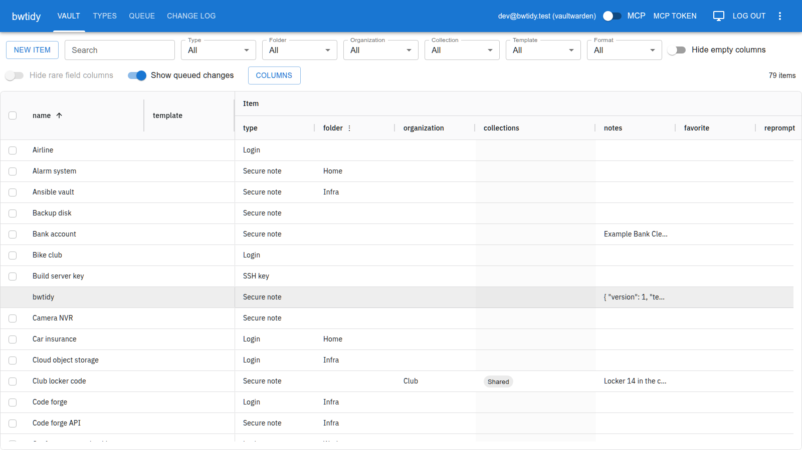

# bwtidy

bwtidy is a web UI and MCP server for keeping a Bitwarden vault tidy. It shows
the whole vault as one wide grid, helps you normalize field names and apply
templates, and lets an AI agent propose reorganizations without seeing secret
values. Every change waits in a queue, gets a backup of the vault before it is
written, and lands in a change log you can restore from.

> **Alpha software.** Most of bwtidy was written with AI coding agents ("vibe
> coded") and it has not been reviewed or audited by anyone else. It changes
> the contents of your password vault. Do not use it in production or on a
> vault you cannot afford to lose. If you try it anyway, keep your own
> Bitwarden export, made outside bwtidy, and expect bugs and breaking changes
> between versions.

bwtidy is an independent project. It is not affiliated with, endorsed by or
sponsored by Bitwarden, Inc. Bitwarden is a trademark of Bitwarden, Inc., used
here only to say which vaults bwtidy works with.

## Running

bwtidy runs as one container with the official Bitwarden CLI inside. It
publishes its web page on port 8765 of the host's 127.0.0.1 and keeps each
account's data in a volume at `/data/accounts`, and its backups at
`/backups`.

How to run it: [Run bwtidy](docs/how-to/run.md), from pulling the image to
the first login, a reverse proxy and updates.

## Documentation

The docs are a site at https://tnek213.github.io/bwtidy/. A running bwtidy
serves the same site at `/docs/`, such as http://127.0.0.1:8765/docs/,
without a login.

- [The documentation site](https://tnek213.github.io/bwtidy/)
- [Documentation home](docs/index.md)
- [Your first cleanup](docs/tutorial/first-cleanup.md): a tutorial from the
  login to a first write and its backup
- [How-to guides](docs/index.md#how-to-guides): run bwtidy, connect an MCP
  client, restore a backup and more
- [Reference](docs/index.md#reference): the web UI, the MCP tools and the
  configuration
- [Explanation](docs/index.md#explanation): how bwtidy works and what it does
  to your vault

## Contributing

- [CONTRIBUTING.md](CONTRIBUTING.md): where to start, and how to report a bug or
  ask for a feature
- [SECURITY.md](SECURITY.md): how to report a security issue, privately
- [The developer guide](dev/README.md): set up, the dev vault, the tests, releasing
- [AGENTS.md](AGENTS.md): the rules every change follows and the checks it
  must pass
- [The architecture](docs/architecture.md): where the code lives
- [The spec](docs/spec.md): what bwtidy does and why

## License

Copyright (C) 2026 Kent Larsson

bwtidy is free software: you can redistribute it and/or modify it under the
terms of version 3 of the GNU Affero General Public License as published by
the Free Software Foundation.

bwtidy is distributed in the hope that it will be useful, but WITHOUT ANY
WARRANTY, without even the implied warranty of MERCHANTABILITY or FITNESS FOR
A PARTICULAR PURPOSE. See the GNU Affero General Public License for more
details. The full text is in LICENSE.

bwtidy changes the contents of a password vault. Keep your own Bitwarden
export, made outside bwtidy, before you use it on a vault you care about.

The container image includes the official Bitwarden CLI, which Bitwarden, Inc.
licenses separately under its own terms (GPL-3.0).

The About page (About bwtidy in the app bar's menu, More actions) shows the
license, links the source code and thanks the projects bwtidy is built on,
with every third-party package bwtidy ships and its license.
