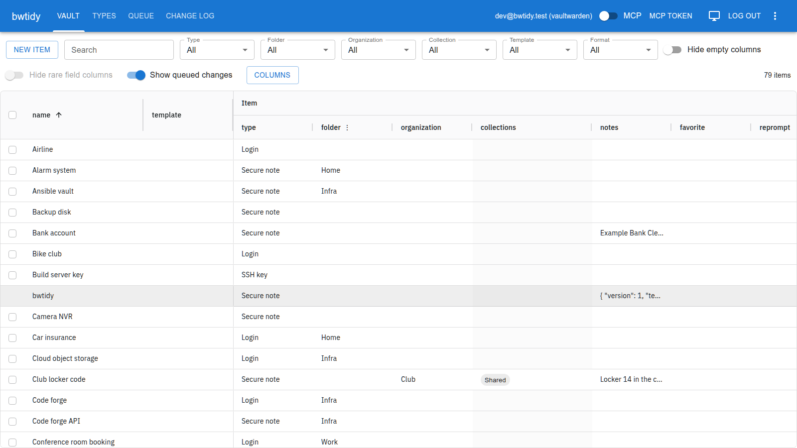

# Quick reference

- **Maintained by**: [the bwtidy project on GitHub](https://github.com/tnek213/bwtidy)
- **Documentation**:
  [tnek213.github.io/bwtidy](https://tnek213.github.io/bwtidy/), also served by
  every running bwtidy at `/docs/`
- **Where to get help**: [GitHub Discussions](https://github.com/tnek213/bwtidy/discussions)
- **Where to file issues**: [GitHub
  issues](https://github.com/tnek213/bwtidy/issues), or privately for a security
  issue as
  [SECURITY.md](https://github.com/tnek213/bwtidy/blob/main/SECURITY.md#reporting-a-vulnerability)
  says
- **Supported architectures**: `amd64`
- **Dockerfile**: [Dockerfile](https://github.com/tnek213/bwtidy/blob/main/Dockerfile)
  in the GitHub repository
- **Source of this description**:
  [docker/hub-overview.md](https://github.com/tnek213/bwtidy/blob/main/docker/hub-overview.md)

# Supported tags

GitHub Actions builds every tag from the
[GitHub repository](https://github.com/tnek213/bwtidy) for `linux/amd64`.

| Tag | What it is |
| --- | --- |
| `latest` | The newest release, betas and release candidates included. A push to main never moves it. |
| A version such as `1.0.0-beta.1` | One release. Its tag never moves to another image. |
| `main` | The newest build of the main branch. Every push to main that changes the image moves it. |
| A short commit (7 hex characters) | The build of that commit of main. A weekly cleanup keeps the 10 newest by push and those of a release. |

Pin a version on a server so that an update is your decision. The
[release notes](https://tnek213.github.io/bwtidy/releases/) say what each
version brings. The [Tags](https://hub.docker.com/r/tnek213/bwtidy/tags) tab
lists every tag.

# What is bwtidy?

<!-- intro: the same text in README.md, docs/index.md and
docker/hub-overview.md -->

Password vaults get inconsistent over time. Some items use `Password` while
others use `password`. Some web addresses include a protocol prefix and others
do not. Bitwarden's apps show one item at a time. That makes these patterns
hard to spot. **bwtidy** shows the whole vault in one grid.

Templates and datatypes help you standardize items of the same kind. A
template defines which fields an item should have. A datatype describes the
expected format of a value. Together they help you find inconsistencies and
tidy the vault.

Use the web UI to make changes directly. You can also connect an AI agent
through MCP. The agent can add proposed changes to a queue without seeing
secret values. You review each proposal and decide whether to accept it. Only
accepted proposals are written to your vault.

Before each write of your changes bwtidy saves a backup of the whole vault.
The backup is an age-encrypted ZIP stored in bwtidy's backups volume. You can
restore it with standard tools. Your vault stays on your Bitwarden or
Vaultwarden server. bwtidy reads and writes vault data through Bitwarden's
official CLI.

bwtidy is for people who want their Bitwarden or Vaultwarden vault to follow
standards they define themselves. It helps them apply those standards
consistently across the vault.

<!-- end of intro -->



<!-- the warning box of README.md without its [!WARNING] line, as Docker Hub
shows the text of a GitHub alert without its formatting -->

> **Made with AI.** AI coding agents wrote all of bwtidy under the author's
> guidance. Claude Fable, Opus and Sonnet built it in many small steps. Codex
> (GPT-6.2-Astra) reviewed it for security and stability. No human has read
> every line. The author uses it for real passwords but the project has few
> users so far. Because bwtidy changes your vault keep an independent Bitwarden
> export made outside bwtidy. Expect bugs and breaking changes between
> versions.

[At a glance](https://tnek213.github.io/bwtidy/#at-a-glance) sums up what
bwtidy does with your vault and your master password.

bwtidy is an independent project. It is not affiliated with, endorsed by or
sponsored by Bitwarden, Inc. Bitwarden is a trademark of Bitwarden, Inc., used
here only to say which vaults bwtidy works with.

# How to use this image

bwtidy runs from its `compose.yaml`, which sets what the container needs. It
runs the image with an init process and a read-only root file system. It
drops every capability the gateway does not need. A stop gets 150 seconds so
that each session can first try to write your unsaved edits. A bare
`docker run` has none of this, so start bwtidy with Compose.

You need Docker with Compose. Download `compose.yaml` and `example.env` into
an empty directory. Then copy `example.env` to `.env` (your settings file) and
start the container.

```console
curl -fsSLO https://raw.githubusercontent.com/tnek213/bwtidy/main/compose.yaml
curl -fsSLO https://raw.githubusercontent.com/tnek213/bwtidy/main/example.env
cp example.env .env
docker compose up -d
```

Before `docker compose up -d` you may set `BWTIDY_VERSION` in `.env` to pin a
version. A Vaultwarden on your own network also needs its URL in
`BWTIDY_ALLOWED_SERVERS`, as bwtidy refuses a server on a private address
otherwise.

Open <http://127.0.0.1:8765> on the host and log in with your Bitwarden or
Vaultwarden account. [Run bwtidy](https://tnek213.github.io/bwtidy/how-to/run/)
goes through the first login and covers a build of your own.
[Update, stop and logs](https://tnek213.github.io/bwtidy/how-to/run/#update-stop-and-logs)
shows how to move to a new version.
[Connect an MCP client](https://tnek213.github.io/bwtidy/how-to/mcp/) shows how
to add bwtidy to your AI agent.

## Port

The gateway listens on port 8000 in the container. It serves the web UI and
the MCP endpoint `/mcp` as well as the documentation site at `/docs/`.
`compose.yaml` publishes it on the host's 127.0.0.1 only, at port 8765.
`BWTIDY_HOST_PORT` in `.env` changes that port.

A reverse proxy on the same host lets other machines reach bwtidy over HTTPS.
[Behind a reverse proxy](https://tnek213.github.io/bwtidy/how-to/run/#behind-a-reverse-proxy)
shows how to set it up.

## Volumes

| Path in the container | What it holds |
| --- | --- |
| `/data/accounts` | Each account's Bitwarden CLI login and its SQLite file with the queue and the Change log. Compose mounts the volume `bwtidy-accounts` here. |
| `/backups` | The age-encrypted backups of every account. Compose mounts the volume `bwtidy-backups` here or the host directory that `BWTIDY_BACKUPS` names. Its file system must let root chown. |

The root file system is read-only. bwtidy writes only to these volumes and
to `/tmp`, which is a tmpfs.
[Files and volumes](https://tnek213.github.io/bwtidy/reference/configuration/#files-and-volumes)
shows what each volume holds. The usage stats are off by default and need a
volume of their own when you turn them on (see
[Usage stats](https://tnek213.github.io/bwtidy/reference/configuration/#usage-stats)).

## Environment variables

You set them in `.env`, and `example.env` says what each one does. These are
the ones you are most likely to change. `BWTIDY_IMAGE` must be set too, and
`example.env` sets it to this image.

| Variable | Default | What it does |
| --- | --- | --- |
| `BWTIDY_VERSION` | `latest` | The image tag that Compose runs. |
| `BWTIDY_HOST_PORT` | `8765` | The port on the host's 127.0.0.1 where the web page is published. |
| `BWTIDY_BACKUPS` | `bwtidy-backups` | The volume or the host directory that holds the backups. |
| `BWTIDY_SECURE_COOKIES` | `0` | `1` marks the cookies Secure when the page is served over HTTPS. |
| `BWTIDY_MCP_HOSTS` | | Host names (comma separated) that `/mcp` accepts besides localhost. Set it behind a reverse proxy. |
| `BWTIDY_ALLOWED_SERVERS` | | Server URLs (comma separated) on a private address that bwtidy may log in to. An example is a Vaultwarden on your own network. |

[Configuration](https://tnek213.github.io/bwtidy/reference/configuration/)
lists every variable. Among them are the session timeouts, the backup
retention and the limits on open accounts.

## About the image

There is one variant. It builds on Debian 13 (trixie) from
`python:3.13-slim-trixie` and holds the official Bitwarden CLI with its own
Node.js. The container runs as root so that the gateway can start each
account's worker under that account's own uid.
[How accounts are kept apart](https://tnek213.github.io/bwtidy/explanation/isolation/)
explains it.

bwtidy ships the open source build of the Bitwarden CLI and follows its new
releases (see
[Which version of the CLI](https://tnek213.github.io/bwtidy/explanation/bw-cli/#which-version-of-the-cli)).

Every image carries a signed build provenance attestation. It shows the
commit of the GitHub repository that GitHub Actions built the image from.
Check it with the GitHub CLI.

```console
gh attestation verify oci://docker.io/tnek213/bwtidy:latest --owner tnek213
```

# License

bwtidy is free software under version 3 of the GNU Affero General Public
License. The full text is in
[LICENSE](https://github.com/tnek213/bwtidy/blob/main/LICENSE).

The container image includes the open source build of the Bitwarden CLI.
Bitwarden, Inc. licenses it separately under GPL-3.0. The image builds it from
Bitwarden's source (<https://github.com/bitwarden/clients>) at the tag
`cli-v2026.11.0`.

The About page of a running bwtidy lists every third-party package that
bwtidy ships with its license. Like every image this one also holds other
software under its own licenses, such as the packages of its Debian base.
