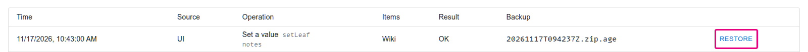

# How edits are saved

Nothing you do in the grid is written to your vault at once. Every edit (a
cell, a dialog, a merge, a template save) goes into a queue, and bwtidy
writes the queue in batches, each with a backup taken first. This page says
what a write does to your vault, and how to undo one.

## The queue and the auto-commit

An edit shows in the grid right away on an amber background, and the app
bar shows Commit now. The auto-commit writes all waiting edits together 180
seconds after the oldest one, or as soon as 20 wait (the Auto-commit box on
the Queue page changes both). Commit now writes them at once. A save on the
Types page or of the generator settings is written right away.

Logging out, switching account or a session that times out writes the
waiting edits first. One that could not be written then stays in the queue
and is written right after the next unlock.

An agent's proposals wait in the same queue, but the auto-commit never takes
them: they are written only when you approve them (see
[What an agent can do](mcp.md)). The only writes that skip the queue are a
few to bwtidy's own note (see [The bwtidy note](tool-note.md)).

## What a write does

1. Sync with the server, so bwtidy sees changes made in other Bitwarden
   apps.
2. Check each edit against the item as it is now. An item that changed
   elsewhere since you edited it (its revision date, its folder, favorite or
   collections) fails the edit as a conflict, and nothing of it is written.
3. Take a backup of the whole vault as it is now, or reuse the newest one
   when the vault has not changed since. No backup, no write.
4. Sync and check once more, as the backup can take a while.
5. Write each item: fetch it whole, change only the values the edit touches
   and put it back, so everything else on it (passkeys, password history,
   attachments, fields bwtidy does not know) stays. The item is checked once
   more right before it is written.
6. Record the write in the change log, reload the vault and start the next
   backup in the background.

While a write runs, the spinner in the app bar says what it does on hover,
such as taking a backup or writing 3 of 5 changes.

## Trash, never delete

A delete moves the item to the trash, where any Bitwarden app can restore
it. Changing an item's type, or taking it out of an organization, creates a
new item and moves the old one to the trash (its passkeys and password
history stay with the old one). bwtidy deletes for good only an empty
folder you delete, and the old file of an attachment you rename once its
copy under the new name is in place (the backup holds the file). When such a
rename fails halfway, it deletes its own copy again.

## The change log

Every write is a row in the Change log: when, from the grid or an agent,
which operation on which items and fields, the result and the backup taken
before it. It never holds a value.

Restore on a row puts its items back as that backup holds them, after a
dialog that says what happens to each one. It is a write like any other, so
it gets a backup and a row of its own, and can be undone in turn. An item
that was deleted for good since is created anew, without its passkeys and
password history. What Restore does on each kind of row is in
[The web UI](../reference/ui.md#change-log).

## When a write fails

An edit that fails its checks is not written. A red message names the item
and the reason, the grid marks what changed elsewhere, and the Queue page
lists the edit under Failed. Retry writes it again (over a change made
elsewhere it asks first, and that change is in the backup), or Dismiss drops
it. A secret value of a failed edit is gone after a restart, so type it
again.

## For developers

Every edit is a queue entry that is checked on arrival with the rules the
write runs, and one write path commits it after a backup. The code behind
this page: [docs/architecture.md, section How a write
flows](../architecture.md#how-a-write-flows).
