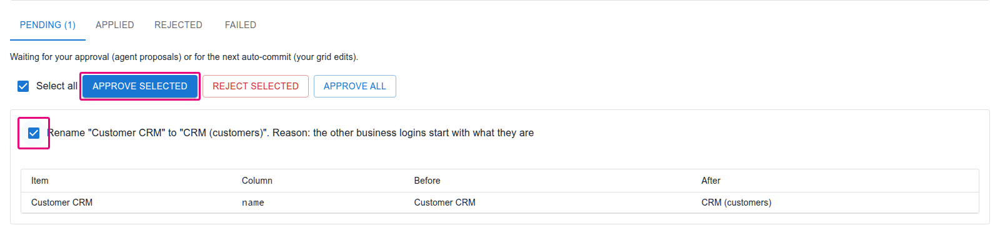

# What an agent can do

bwtidy is an MCP server too, so an AI agent such as Claude Code or Codex can
look through your vault and suggest how to tidy it. The agent never writes
and never sees a secret value: it proposes, and you decide. To connect one,
see [Connect an MCP client](../how-to/mcp.md). Every tool it can call is in
[MCP tools](../reference/mcp-tools.md).

## What it can see

- Every item with its plain values: name, type, folder, organization,
  collections, notes, username, URIs (with their match setting), text
  custom fields, and attachment file names and sizes.
- Which secret fields an item has set, but never their values (see
  [Secret values and backups](secrets.md)).
- The folders, collections, templates and datatypes, how well each item
  fits its template, and near-duplicate field names.
- Its own proposals and what became of them.

It never sees the bwtidy note, the contents of an attachment, the backups or
the change log.

## What it can propose

Moving items (into a folder, an organization or the personal vault),
setting their collections, renaming, converting, merging and trashing them,
renaming and merging fields, applying a template, renaming and deleting folders, setting
URIs and their match, renaming an attachment, and creating an item. A new
item's secret fields stay blank for you to fill in, or get a generated
value nobody sees until you reveal it in the grid.

A proposal that would copy a secret value into a plain one (a guessed
password as a new name, say) is refused without telling the agent, so it
cannot use refusals to guess. You see it under Rejected.

The agent can also end your session, or log the Bitwarden CLI out. Its
instructions say to do that only when you ask.

## You approve every change

Each proposal waits on the Queue page with its summary (and the agent's
reason, when it gave one) and a diff of what it changes, secret values
masked. The auto-commit never takes it. Approve or reject them one by one
or several at once. An approved batch is written like any edit, with a
backup first and a row in the change log (see [How edits are
saved](edits.md)).

## The token and the switch

- The token picks the account: an agent reaches only the account whose
  token it holds. bwtidy keeps only a hash of it, so it shows the token once.
- MCP works only while it is switched on in the app bar, and only while you
  are logged in with a tab open. Every login starts with it off.
- The server answers only requests addressed to localhost, or to a host
  name you allowed (`BWTIDY_MCP_HOSTS`), so a web page cannot reach it.

## For developers

The read tools answer from a view that hides the tool note and the secret
values, and every propose tool puts an entry in the same queue as the UI's
edits. The code behind this page: [docs/architecture.md, section How a write
flows](../architecture.md#how-a-write-flows), which ends with an MCP
proposal.
