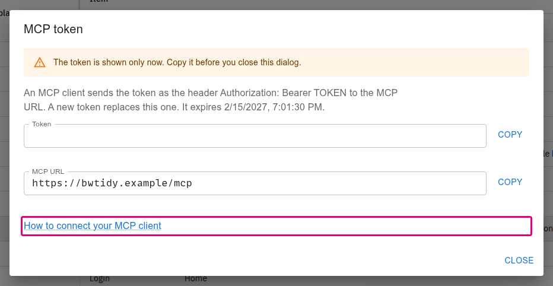

# Connect an MCP client

bwtidy serves an MCP server over streamable HTTP at `/mcp` of its address.
An AI agent connected to it can look through your vault without the secret
values and propose changes. Its proposals are written only once you approve
them on the Queue page. [What an agent can do](../explanation/mcp.md)
explains what an agent sees and may propose. [MCP tools](../reference/mcp-tools.md)
lists the tools it can call.

The commands below use two placeholders. URL is the address you open bwtidy
at without a path, such as https://bwtidy.example or http://127.0.0.1:8765
on the same host. TOKEN is your MCP token. The commands write the MCP address
as `URL/mcp`, which is also how the token dialog's MCP URL field shows it.
You can paste that field in place of `URL/mcp`.

## Make a token

1. Log in to bwtidy and click MCP token in the app bar, then Create.
2. Pick how long the token lives and click Create. It lives 90 days unless
   you pick 7, 30 or 365 days or No expiry. A token without an expiry works
   until you remove it.
3. The dialog shows the token only this once, as bwtidy keeps just a hash
   of it. Copy it before you close the dialog. The dialog also holds the MCP
   URL (`URL/mcp`) to copy and a link to this page.

    

Then put the token and the MCP URL into the command of your client below.

## Claude Code

```sh
claude mcp add -s user --transport http bwtidy URL/mcp --header "Authorization: Bearer TOKEN"
```

Claude Code saves it in `~/.claude.json` for your user, so it works in every
directory.

## Codex

```sh
export BWTIDY_MCP_TOKEN=TOKEN
codex mcp add bwtidy --url URL/mcp --bearer-token-env-var BWTIDY_MCP_TOKEN
```

Codex saves it in `~/.codex/config.toml` for every directory. It reads the
token from the variable `BWTIDY_MCP_TOKEN` each time it starts, so set that
variable in your shell profile or wherever else Codex gets its environment.

## GitHub Copilot CLI

```sh
copilot mcp add --transport http --header "Authorization: Bearer TOKEN" bwtidy URL/mcp
```

Copilot CLI saves it in `~/.copilot/mcp-config.json` for your user.

## Gemini CLI

```sh
gemini mcp add -s user --transport http --header "Authorization: Bearer TOKEN" bwtidy URL/mcp
```

Gemini CLI saves it in `~/.gemini/settings.json` for your user. Without
`-s user` it saves it for the current project only.

## Another client

Have the client send the header `Authorization: Bearer TOKEN` with every
request to `URL/mcp`.

## Switch MCP on

Click the MCP switch in the app bar. It turns green and the app bar takes on
a red tint while MCP is on. Every login starts with MCP off, so switch it on
again after each login. The switch turns on only while you have a token that
has not expired. Otherwise it says why.

## Look after the token

The MCP token menu in the app bar shows when the token was made, when it
expires and when it was last used. It also holds the two actions for the
token:

- Replace opens the same dialog as Create. Once you click Create there, the
  new token is made and the old one stops working at once. Update your
  client with the new one.
- Remove deletes the token, so no client gets in with it any longer.

A chip in the app bar warns when 3 days or 15% of the token's lifetime are
left, whichever comes first. Replace the token then and update your client.

## Behind a reverse proxy

The MCP server answers only requests addressed to 127.0.0.1, localhost or
::1. Behind a reverse proxy you add your host name to `BWTIDY_MCP_HOSTS` in
`.env`, such as `BWTIDY_MCP_HOSTS=bwtidy.example`. Several names are
separated by commas. Then start it again with `docker compose up -d` from
[Start it](run.md#start-it).
[Behind a reverse proxy](run.md#behind-a-reverse-proxy) has the whole proxy
setup.

## When a request fails

bwtidy checks every request to `URL/mcp` in the order below. The first check
that fails decides the answer your client gets. The last check is for tool
calls only, so a client still connects and lists the tools while MCP is off.

```graphviz alt="bwtidy checks a request to URL/mcp in five steps. A missing or unknown token gets a 401 that asks for a token. An expired token gets a 401 that says it expired. A token whose account is not logged in gets a 503 that says the account is locked. A host name that is not allowed gets a 421. While MCP is switched off or the session has ended every tool call answers that bwtidy MCP is disabled. Only a request that passes all five checks reaches the tool."
digraph {
  nodesep=0.4
  ranksep=0.3
  fontname="sans-serif"
  node [fontname="sans-serif" fontsize=13 shape=box style="rounded,filled" fillcolor="#ffffff" color="#5c6bc0" margin="0.12,0.06"]
  edge [fontname="sans-serif" fontsize=12 color="#455a64"]
  request [label="A request to URL/mcp" fillcolor="#e8eaf6"]
  known [label="Does the token match an account?"]
  valid [label="Is the token still valid?"]
  loggedin [label="Is that account logged in?"]
  host [label="Is the host name allowed?"]
  on [label="Is MCP switched on\nin a logged in session?"]
  tool [label="The tool answers" fillcolor="#f1f8e9" color="#558b2f"]
  node [fillcolor="#fff3e0" color="#e65100"]
  notoken [label="401 bwtidy MCP needs a token"]
  expired [label="401 bwtidy MCP token expired"]
  locked [label="503 bwtidy is locked for this account"]
  badhost [label="421 Invalid Host header"]
  disabled [label="Every tool call answers\nbwtidy MCP is disabled"]
  { rank=same; known; notoken }
  { rank=same; valid; expired }
  { rank=same; loggedin; locked }
  { rank=same; host; badhost }
  { rank=same; on; disabled }
  request -> known
  known -> valid [label=" yes"]
  valid -> loggedin [label=" yes"]
  loggedin -> host [label=" yes"]
  host -> on [label=" yes"]
  on -> tool [label=" yes"]
  known -> notoken [label="no"]
  valid -> expired [label="no"]
  loggedin -> locked [label="no"]
  host -> badhost [label="no"]
  on -> disabled [label="no"]
}
```

Each answer has its own fix.

- A 401 that says the token expired needs a new token. Make one with
  Replace and update your client.
- Any other 401 means the header is missing or the token is wrong or
  removed. Check the token in your client or make a new one.
- A 503 means the account the token belongs to is not logged in. Log in to
  that account in the web UI.
- A 421 that says Invalid Host header means the host name your client uses
  is missing from `BWTIDY_MCP_HOSTS`. Add it as in
  [Behind a reverse proxy](#behind-a-reverse-proxy).
- When every tool call answers that bwtidy MCP is disabled, switch MCP on in
  the app bar. The tools answer only while your session runs, so log in
  again if it has ended (see
  [The session](../explanation/login.md#the-session)).
