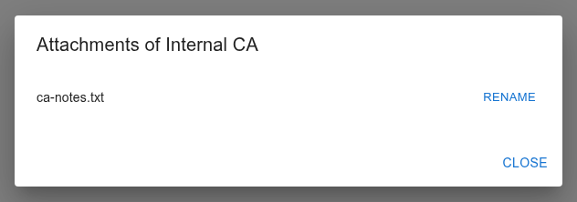

# Rename an attachment

Right click the attachments cell of an item that has attachments. Pick
Rename attachments in the Cell part of the menu.

A dialog lists the item's attachments by file name. Click Rename next to the
one you want and type the new name. Then click Save.

Save stays off for an empty name or a name with a slash or a backslash. It
also stays off for the name the attachment has now. The name of another
attachment of the item is taken too, even in other letter case (Straße.txt
and STRASSE.txt count as one name). You can still change the case of the
attachment's own name. Once you type, the reason Save is off shows under the
field. Cancel keeps the old name and Close leaves the dialog without a change.

Save closes the dialog and puts the rename in the queue like any other edit
(see [How edits are saved](../explanation/edits.md)). Until it is written the
dialog says the rename is queued and the attachment's Rename button stays
off.

bwtidy cannot change a file name in place. The write uploads the file under
the new name and then deletes the old one, so the attachment gets a new id.
The backup taken before the write holds the old file. Restore on the
rename's row in the [Change log](../reference/ui.md#change-log) asks first
and then queues a rename back to the old name. The dialog never shows or
fetches a file's contents.
