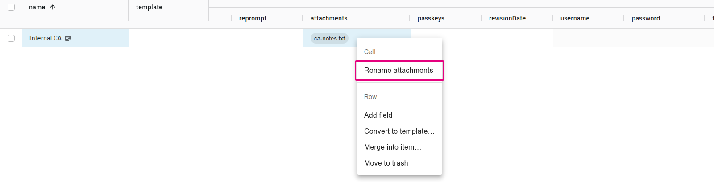

# Rename an attachment

1. Right click the attachments cell of an item with attachments and pick
   Rename attachments in the Cell part of the menu.

   

2. The dialog lists the item's attachments by file name. Click Rename on the
   one you want, type the new name and click Save.

   

Save stays off, with the reason under the field, for an empty name, a name
with a slash or a backslash, the name it has, or the name of another
attachment of the item. Close leaves the dialog without a change.

The rename is an unsaved change like any edit (see
[How edits are saved](../explanation/edits.md)), and the attachment says it
is queued until it is written. bwtidy uploads the file under the new name and
deletes the old one, so the attachment gets a new id. The dialog never shows
or fetches a file's contents.
