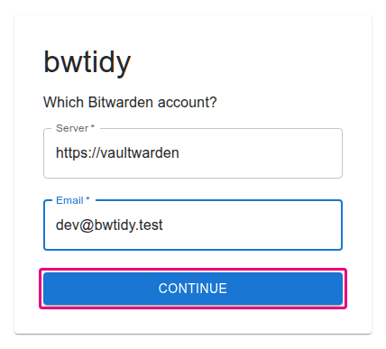
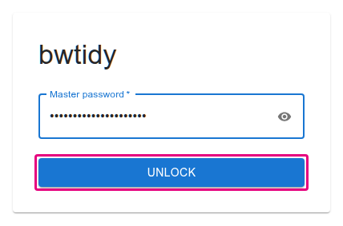

# Run bwtidy

bwtidy runs as one Docker container with the official Bitwarden CLI inside.
You need Docker with Compose. The usual way is the ready-made image
`docker.io/tnek213/bwtidy` from Docker Hub. `compose.yaml` pulls it, so you
have nothing to build. The image has two kinds of tags:

- `latest` and the versions (like `0.1.0-alpha.1`) are releases. The
  [Release notes](../releases.md) say what each one brings.
- `main` and the short commits follow every push to main that changes the
  image. Older short commits are deleted after a while, except those of a
  release.

GitHub Actions builds every published image from this repository. It signs
a provenance attestation for each one, which shows the commit the image was
built from.
[Verifying the image in SECURITY.md](https://github.com/tnek213/bwtidy/blob/main/SECURITY.md#verifying-the-image)
shows how to check it. You can also
[build the image yourself](#build-the-image-yourself).

## Start it

Get `compose.yaml` and `example.env` by cloning the repository. You can also
download
[compose.yaml](https://raw.githubusercontent.com/tnek213/bwtidy/main/compose.yaml)
and [example.env](https://raw.githubusercontent.com/tnek213/bwtidy/main/example.env)
into one directory instead. Then copy
`example.env` to `.env`, which is your settings file. With a clone it takes
these two commands.

```sh
git clone https://github.com/tnek213/bwtidy.git bwtidy && cd bwtidy
cp example.env .env
```

Each setting is a variable in `.env`, and `example.env` says what it does.
The defaults are fine to start with.
[Configuration](../reference/configuration.md) lists them all.

You can pin `BWTIDY_VERSION` in `.env` to a version instead of `latest`.
Then start the container.

```sh
docker compose up -d
```

Open <http://127.0.0.1:8765> on the host. Compose publishes only that port and
only on the host's 127.0.0.1 (`BWTIDY_HOST_PORT` in `.env` changes the
port). These docs are at <http://127.0.0.1:8765/docs/> for anyone who can
reach that address, without a login.

## Log in the first time

The first login goes through a few forms and may need a code from your
mail.

1. Enter the server and your email, then click Continue. The server is
   <https://vault.bitwarden.com> unless you use another one.

    

2. For an account bwtidy does not know yet, a dialog offers to create it.
   Click Create. bwtidy keeps a new account only when its first login and
   unlock succeed.
3. bwtidy shows a Bitwarden login with the server and email filled in. Type
   your master password and click Log in. A console below the form shows
   what the Bitwarden CLI prints.
4. On a first login from a new device bitwarden.com emails you a one-time
   code. Type it into Answer to the CLI under the console and press Enter.
   An account with two-step login asks for its code in the same field.

bwtidy then unlocks the vault with the same master password, so you type it
only once. From then on the page asks only for the master password to
unlock. It shows "Starting" for a few seconds while the account's worker
starts.



The browser remembers the account. One browser profile works with one
account at a time, but several accounts can use the same URL. Each one is
kept apart from the others (see
[How accounts are kept apart](../explanation/isolation.md)).

[Logging in](../explanation/login.md#the-session) explains when the session
ends and what happens to your unsaved changes then.

> [!WARNING]
> Do not run `bw unlock`, `bw lock` or `bw logout` in the container while you
> are logged in to the web UI. Each of them invalidates the session key
> bwtidy uses for backups (see
> [How bwtidy uses the Bitwarden CLI](../explanation/bw-cli.md)).

## Build the image yourself

Build the image from a checkout instead of pulling it when you want to run
unreleased code or only what you built yourself. `compose.build.yaml` adds
the build to `compose.yaml`. It builds the target `app` of the `Dockerfile`
from the checkout and names the image `bwtidy:local`. Everything else comes
from `compose.yaml` and `.env`.

Building with Compose needs buildx 0.17 or later. The build also draws the
diagrams of these docs on a Kroki server. That is <https://kroki.io> unless
the build arg `BWTIDY_KROKI_URL` names your own, which `compose.build.yaml`
takes from the environment (see the section Diagrams of `dev/release.md`).

```sh
git clone https://github.com/tnek213/bwtidy.git bwtidy && cd bwtidy
cp example.env .env
BWTIDY_COMMIT="$(git log -1 --format='%cd %h' --date=format:%y%m%d)" \
  docker compose -f compose.yaml -f compose.build.yaml up -d --build
```

The version comes from `backend/pyproject.toml` in the checkout. The build
has no `.git`, so the commit comes in as the build arg `BWTIDY_COMMIT`. It
holds the committer date (YYMMDD) and the short hash with a space between
them, the way the project's own image workflow sets it.

The About page then shows both, like `0.1.0-alpha.1 (261111 7db8830)`.
Without the commit it shows the version alone. The published images also
carry the OCI labels `org.opencontainers.image.version` and
`org.opencontainers.image.revision`. The workflow sets them and a build of
your own leaves them out.

With a buildx older than 0.17, build with plain Docker first. Then start it
without `--build`.

```sh
docker build --target app -t bwtidy:local \
  --build-arg BWTIDY_COMMIT="$(git log -1 --format='%cd %h' --date=format:%y%m%d)" .
docker compose -f compose.yaml -f compose.build.yaml up -d
```

To update, run `git pull` and then the same commands again.

## Behind a reverse proxy

A reverse proxy (Caddy, nginx or Traefik) on the same host lets other
machines reach bwtidy. It terminates TLS and forwards plain HTTP to
`127.0.0.1:8765`.

```mermaid alt="A browser and an MCP client connect over HTTPS to the reverse proxy at bwtidy.example. The proxy terminates TLS and forwards plain HTTP to the host's 127.0.0.1:8765. Docker passes that port on to the bwtidy container on the same host."
%%{init: {"htmlLabels": false, "flowchart": {"htmlLabels": false, "rankSpacing": 32, "nodeSpacing": 24}}}%%
flowchart LR
  browser["Browser"]
  agent["MCP client"]
  subgraph host["Your host"]
    proxy["Reverse proxy<br/>terminates TLS"]
    bwtidy["bwtidy container"]
    proxy -- "HTTP to<br/>127.0.0.1:8765" --> bwtidy
  end
  browser -- "HTTPS to<br/>bwtidy.example" --> proxy
  agent -- "HTTPS to<br/>bwtidy.example" --> proxy
```

Then set these two in `.env` with your own host name and run
`docker compose up -d` again.

```sh
BWTIDY_SECURE_COOKIES=1
BWTIDY_MCP_HOSTS=bwtidy.example
```

The first marks the cookies Secure. The second lets `/mcp` accept requests
addressed to your host name, which it reads from the Host header. So the
proxy must pass that header on unchanged. Caddy and Traefik do so by
default, while nginx needs `proxy_set_header Host $host`.
[Configuration](../reference/configuration.md#set-in-env) has the details of
both settings.

## Update, stop and logs

- To update the published image, change `BWTIDY_VERSION` in `.env` or keep
  `latest`. Then run `docker compose pull && docker compose up -d`. Your data
  is kept.
- `docker compose down` stops bwtidy. The stop ends every session,
  which first tries to write your unsaved edits (see
  [Logging in](../explanation/login.md#the-session)). The volumes stay and
  with them your accounts and their backups. `docker compose down -v`
  deletes the volumes, but a backup directory on the host stays.
- Run `docker logs bwtidy` to read the gateway's log. Each account's worker
  writes `worker.log` in its account directory (see
  [Files and volumes](../reference/configuration.md#files-and-volumes)).

The About page (More actions, About bwtidy) shows the version and the commit
the running image was built from.
