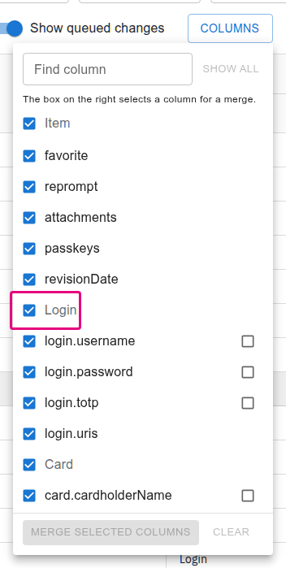

# Show or hide columns

The Columns button above the grid opens the column chooser. It lists every
column under its group (Item, Login, Card, Identity, SSH key, Custom fields),
each with a checkbox that shows or hides it.

- Tick or untick a column's checkbox to show or hide it. `name` can never be
  hidden.
- Tick or untick a group's heading, like Login here, to show or hide the
  whole group in one click. It is checked while every column of the group is
  shown, unchecked while none is, and half checked in between.
- Type in Find column to narrow the list. A group's checkbox then acts only
  on the columns the search lists.
- Click Show all to bring every hidden column back.

The box on the right of a column selects it for Merge selected columns (see
[Toolbar](../reference/ui.md#toolbar) in The web UI).
