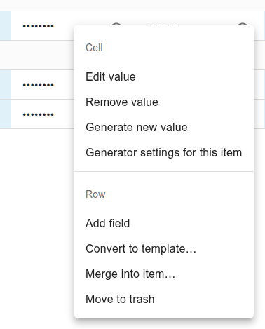
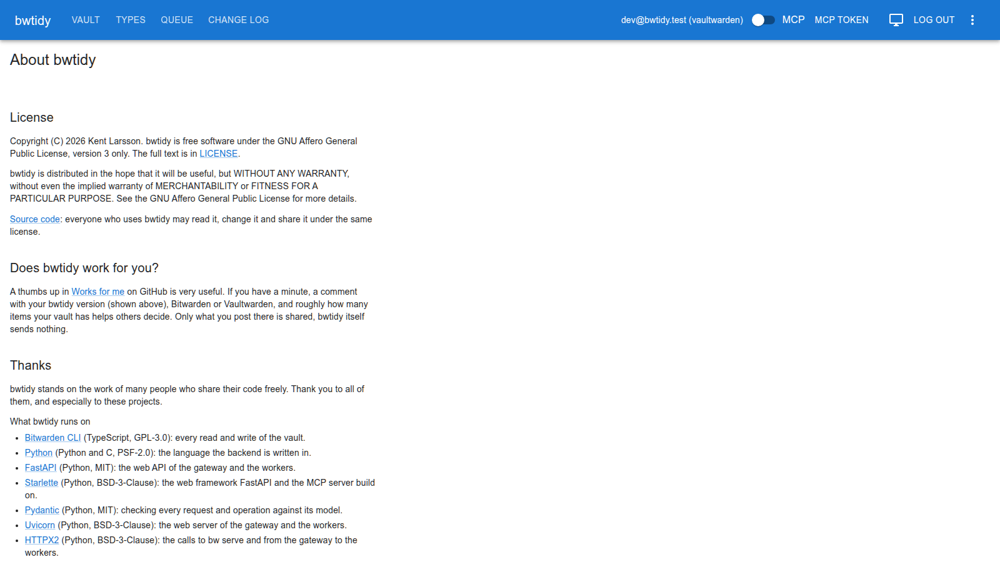
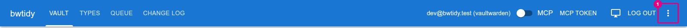

# The web UI

Every page, menu and button of bwtidy, in the order of the app bar: Vault,
Types, Queue and Change log, then the pages that open from elsewhere, then the
app bar itself.

The pictures show bwtidy's test vault as the app looks now (the docs tests
take them, see the developer guide `dev/testing.md` in the repository). A
magenta outline marks what to look at or click, a number in its corner gives
the order of the clicks.

Every edit you make waits in the queue as an unsaved change until the
auto-commit writes it, see [How edits are saved](../explanation/edits.md).

## Vault

The grid: one row per item, one column per place a value can be (a
coordinate, like `login.username` or `fields.PIN`), under the groups Item,
Login, Card, Identity, SSH key and Custom fields. `name` and `template` stay
pinned on the left. A header's tooltip gives the full coordinate and how many
items have a value in it.

### Toolbar

- New item: opens the New item dialog, see [New item](#new-item).
- To fill in (N): shows only the items with a secret field on your To fill
  in list, the empty secret fields you still have to fill in (see
  [The bwtidy note](../explanation/tool-note.md#what-it-holds)). There while
  the list is not empty, a second click shows every row again.
- Own generator settings (N): shows only the items with a generator setting
  of their own. There while at least one item has one.
- Search: keeps the rows where every word is in some value (never a secret
  one) and tints the cells that hold a word.
- Type, Folder, Organization, Collection: keep the rows with that value. No
  folder, Personal and No collection keep the rows without one.
- Template: keeps the items that match a [template](#templates), its near
  misses (Near misses of NAME), or the items that match none (No template).
- Format: Off their format keeps the rows with a value that does not fully
  match its [datatype](#datatypes) (an empty one too), Partial those that
  match in part.
- Hide empty columns: hides the columns with no value in the shown rows.
- Hide rare field columns: hides the columns that went into Rare fields (see
  [Cells](#cells)). Off while Rare fields is off, and on by itself once N is
  above 0.
- Show queued changes: shows the changes waiting in the queue as if they
  were written. On by default.
- Columns: the column chooser, see
  [Show or hide columns](../how-to/show-hide-columns.md). Its Merge selected
  columns opens Merge columns for the columns you selected for merge (two or
  more), where you pick the Target column. Clear deselects them.
- N items, or N of M items: how many rows the filters keep.

### Cells

- Double click, Enter or typing: edits the cell. Text in place, `login.uris`
  and `collections` in a list dialog, `folder` as a pick of the folders or a
  new one, `organization` in a dialog, a secret in a dialog that never shows
  the current value (Show what I type shows what you type).
- Right click, the context menu key or Shift+F10: opens the
  [cell menu](#cell-menu).
- The eye of a secret cell: Reveal shows the value for 30 seconds or until
  the row scrolls away, Hide hides it at once. See
  [Secret values and backups](../explanation/secrets.md).
- The checkbox at the start of a row: ticks the item for the
  [selection bar](#selection-bar). Shift-click ticks a range, the header's
  checkbox every shown row.
- `template`: the matching template, or the closest one with how much of it
  is filled (`Computer 3/4`). Hover a near miss for what it lacks.
- Rare fields (the last column): for each item, the fields that at most N
  items use, as JSON in one cell (`{ "sudo": "", "vlan": "20" }`, a secret
  value behind an eye). Set N in its header menu, 0 (the default) turns it
  off. N is kept for the account.
- A double click on a column header's right edge fits the column to its
  content.

What a cell's look tells you:

- Amber background: a change waits in the queue. Its tooltip names the entry
  and, for your own edits, when the auto-commit writes it. A cell with an
  agent's proposal cannot be edited until you approve or reject it.
- Faded and struck through: the row is queued for the trash.
- Light purple: the item changed elsewhere since you edited it, the cells
  that changed a little stronger. The marks stay until your next edit.
- Faint grey: the cell cannot hold a value (a login field on a card, say),
  the tooltip says why.
- Orange outline: the cell is on your To fill in list. A double click fills
  it in.
- A small round mark top right: how well the value matches its datatype,
  filled for a full match, half filled for part, empty for none.
- A tiny tune icon bottom left: the item has its own generator setting.
- A warning colored corner top left: a text field in a column that is secret
  on other items, so an agent can read it through MCP.

### Cell menu

Right click a cell. The Cell part acts on the cell, the Row part on the item.
Only the entries that fit the cell show. On bwtidy's own note every entry is
disabled.

- Edit value: edits the cell, like a double click.
- Remove value: removes the value from the item.
- Mark to fill in: puts an empty secret cell on your To fill in list.
  Unmark takes a cell off it.
- Generate new value (a password or hidden field): replaces the value with a
  generated one, after a question. The old value stays in the item's password
  history.
- Generator settings for this item: the options of the password generator for
  this item alone (for an app that cannot take long passwords). Use the
  default turns them off again.
- Rename attachments (an attachments cell): see
  [Rename an attachment](../how-to/rename-attachment.md).
- Add field: adds a custom field to the item, with a name, a value and the
  type text or hidden.
- Convert to template…: maps the item's values onto the coordinates of a
  template you pick. For another item type bwtidy creates a new item and
  moves the old one to the trash.
- Merge into item…: moves values of this item into another one, each into a
  column you pick (or Don't move), then moves this item to the trash. A list
  going into a list offers Add to the list or Replace.
- Move to trash: moves the item to the trash, after a question.

### Header menu

The three dots in a column header open its menu. A field column's menu:

- Rename field…: renames the custom field in every item that has it. A name
  another field has already makes it a merge.
- Merge into…: merges the column into a target column you pick.
- Merge near duplicates…: merges the column with the columns whose names
  differ only in case or spaces. There when such columns exist, which a
  colored dot in their headers marks (its Merge these does the same).
- Select for merge: selects the column for Merge selected columns in the
  column chooser. Deselect for merge takes it out.
- Set N (the Rare fields column): sets N from 0 to 99, see Rare fields
  above.
- Manage folders… (the Folder column): lists every folder with its number of
  items. Rename gives a folder a new name in place, Delete deletes an empty
  one (a folder that holds items, also in the trash, cannot be deleted).

A merge that finds items with a value in more than one of the columns asks
which value each of them keeps (Choose the values to keep).

### Selection bar

Below the grid while any row is ticked.

- N selected: how many items are ticked.
- Move to trash: moves them all to the trash in one write, after one
  question that lists them.
- Clear: unticks every row.

### New item

New item adds an item from a type (Login, Secure note, Card, Identity, SSH
key) or a stored template (Start from), with its Name, Folder, Organization
and fields.

- Type the secret fields in the dialog, hidden until you tick Show what I
  type, or leave one of a raw type empty and it goes on your To fill in list.
- Generate a password (a login, on by default): the password is generated
  and nobody sees it until you reveal it in the grid.
- From a template every field must be filled and fit its datatype's format,
  or Create stays disabled. A field marked optional may stay blank. For a
  field name pattern (like `user_*`) you name the field too.
- An SSH key needs only its private key (OpenSSH or PEM, without a
  passphrase): bwtidy fills in its public key and fingerprint.
- Create: queues the new item. It shows in the grid once it is written.

### Alerts

- bwtidy's note is named "NAME" now: bwtidy's own note was renamed in
  another app. Rename it back gives it its name again.
- Backups not re-encrypted (after a login with a new master password): the
  backups it names could not be opened with the stored password and are left
  as they were.

## Types

Two tabs, Templates and Datatypes. A save closes the editor at once and the
list shows a Saving chip until it is written. A refused save opens the editor
again with the reason.

### Templates

A template says which fields an item of a kind should have. An item matches
it when it has the template's type and a value in every required coordinate.

- New template: opens the template editor.
- The list: Name, Description, Type, Coordinates (one chip each, with its
  datatype and `optional` or `pattern`), Matching items, and Edit and Delete
  (Delete asks first). A warning above it names a template that duplicates an
  earlier one, or a datatype that is unknown or broken.

The template editor:

- Name, Type and Description. Under Type: what the type is for and what it
  is not for.
- Add coordinate: adds a row. Its Coordinate picks a built-in slot of the
  type or a field of the vault, New field… one the vault does not have yet,
  Field name pattern… a pattern like `user_*` for several fields at once.
- Field type (Text, Hidden or Boolean), Datatype and Optional (not needed for
  a match) per row, and ✕ that removes the row.
- Save: saves the template. A coordinate no item has gets a light warning
  background.

### Datatypes

A datatype is a named pattern a template coordinate can use. It says how
well a value matches its format, never whether the value is right.

- New datatype: opens the datatype editor.
- Pattern limits and statistics: opens the [Statistics](#statistics) page.
- The list: Name (with Broken and the reason when it is), Pattern,
  Description, Coordinates using it, and Edit and Delete. A datatype that a
  template uses cannot be deleted.

The datatype editor:

- Name, Regular expression (the help icon after "Supports" lists the syntax
  it takes), Whole value (the pattern must match the whole value, else any
  part of it) and Ignore case. Under the pattern its states, largest repeat
  and shortest match, or the error at its column.
- Description.
- Examples and Counter-examples, one per line: values that must match and
  values that must not. A tick or a cross marks each line, red when it is
  wrong. Make them up, an agent can read them.
- Try: values to check, never saved.
- Save: on once the examples are right and the name is free.

## Queue

What waits to be written: your edits until the auto-commit, an agent's
proposals until you decide. See [How edits are saved](../explanation/edits.md).

- Auto-commit: After seconds and Or at changes set when your edits are
  written, Save keeps them.
- The tabs Pending, Applied, Rejected and Failed, each with the number of
  entries you have not seen.
- An entry: its summary, then its number, its source (ui or mcp), when it
  was made and its operation, and a table of each changed cell (Item, Column,
  Before, After) with the secret values masked.

On Pending:

- Select all, and a checkbox per entry.
- Approve selected: writes the ticked entries, as one write with one backup.
- Reject selected: rejects the ticked entries. Nothing is written.
- Approve all: writes every pending entry.

On Failed:

- Retry: writes the entry again. Over a change made elsewhere it asks first
  (Write over the other change?), Cancel leaves the entry as it is.
- Dismiss: deletes the entry and its marks in the grid.

## Change log

Every write with the fields it changed and its backup, the vault as it was
right before that write, newest first.

- From, To, Source, Operation, Field, Items and Result narrow the rows.
  Clear filters empties them all.
- Diff report: lists every operation on every field of the shown rows, to
  Copy as text.
- The columns: Time, Source, Operation (hover it for what it did), Items,
  Result and Backup.
- A backup's name: downloads the encrypted file. Decrypt it with
  `age -d` and the master password.
- Restore on a row: puts its items back as that backup holds them, after a
  dialog that says what happens to each item. On a folder's row it gives the
  folder its old name back, or creates a deleted one again, and on an
  attachment rename's row the attachment its old name. The restore is a
  write like any other, with a backup first and a row of its own.
- A small restore icon marks a change that a later restore undid. Its
  tooltip says when and which fields of which items.
- Delete on a backup row: deletes that backup for good, after a question.
  The newest backup cannot be deleted, nor one that a running write or a
  queue entry still needs (the dialog says why).

## Settings

Opens from More actions. Three sections: Display (the first three below),
Password generator and Delete data.

- Date and time format: System (the browser's own), ISO 8601, Europe, Europe
  (dots) or USA. Every date and time follows it. Kept for the account, so
  every browser shows the same.
- Layout: Normal or Compact, which fits more in a small window. Kept in this
  browser only.
- Hide bwtidy's own note: leaves the note that keeps your templates and
  settings out of the Vault grid (see [The bwtidy note](../explanation/tool-note.md)).
- Password generator: Password or Passphrase, with the options of
  Bitwarden's own generator, an Example (Another example makes a new one) and
  Save. It is the default, an item can have its own from the cell menu.
- Delete my data: deletes every backup, the change log and the decided queue
  entries. The settings, the MCP token and the templates stay.
- Delete my account: deletes all of that, the settings and the MCP token,
  logs out of Bitwarden and removes the account from bwtidy.

Both Delete buttons ask you to type your email first. While edits are
pending they ask whether to write them first or drop them.

## Statistics

Opens from Pattern limits and statistics on the Datatypes tab. How close
values and patterns come to the limits of the datatype checks, kept in
memory for this session only.

- Limits: the longest pattern, the largest repeat count, the most states,
  the deepest nesting and the longest value bwtidy checks.
- Datatypes: per datatype its size (States, Largest repeat, Shortest match),
  how many values it scored, how many were too long, the slowest value and
  the last reload in ms.
- Scored values: per item and column, the value's length (never the value),
  its distance from the format, the largest repeat it used, the steps and the
  time. The slowest come first, a click on a header sorts by that column.

## About

About bwtidy opens the About page: the version, the license, the link to the
source code, a link to the Works for me discussion on GitHub and the thanks to
the projects bwtidy is built on, with the packages and their licenses.

If bwtidy works for you, a thumbs up in Works for me helps others decide, and
a comment with your bwtidy version, Bitwarden or Vaultwarden, and roughly how
many items your vault has helps even more. Only what you post there is
shared: bwtidy itself sends nothing.

The version follows [Semantic Versioning 2.0.0](https://semver.org):
MAJOR.MINOR.PATCH, pre-releases as `-alpha.N`, `-beta.N` and `-rc.N`, and
while MAJOR is 0 anything may change. The About page shows it followed by the
commit the running image was built from, like
`Version 0.1.0-alpha.1 (261111 7db8830)`. The app bar shows the short commit
faintly after the title, like `7db8830`.

## Login pages

The account form, the Bitwarden login and the unlock come before the app (see
[Logging in](../explanation/login.md)). Until someone has logged in with any
account, they show a note "Before you start" above the form. It links to the
alpha caution in the README on GitHub and to the Works for me discussion, and
the form under it works as usual. After the first login of any account it
never shows again. It comes back only when every account is deleted, as on a
fresh start.

## App bar

- bwtidy (the title): goes to the Vault.
- Vault, Types, Queue, Change log: the pages. Queue's number counts the
  pending entries, its tooltip how many are your unsaved edits and how many
  an agent's proposals.
- Commit now: writes your unsaved edits at once. There while you have some,
  with a spinner while a write runs (hover it for what it does).
- The account: the email of the open account, with the server's host when
  it is not bitwarden.com.

### MCP

- MCP: switches the MCP server on or off for this session. Green while on,
  and the app bar takes on a red tint.
- MCP token: shows when the token was made, expires and was last used, with
  Create (or Replace) and Remove. A chip next to it warns before the token
  expires. Create and Replace open a dialog with the new token (shown only
  once), the MCP URL, both with a Copy button, and a link to how to connect
  your client.

How to use both: [Connect an MCP client](../how-to/mcp.md). What they give
an agent: [What an agent can do](../explanation/mcp.md). What it can call:
[MCP tools](mcp-tools.md).

### Color mode

The monitor, sun or moon button picks System, Light or Dark. System follows
the browser's color scheme. The choice is kept in this browser.

### Log out

Log out asks first. As it is, it ends the bwtidy session and keeps the
Bitwarden CLI logged in. With "Also log out of Bitwarden" checked it logs the
CLI out too, and the next login runs the Bitwarden login again
(bitwarden.com may email a new device code). Only a running session logs the
CLI out: when the session already ended, the page asks you to unlock first.
Your unsaved changes are written first. See [Logging in](../explanation/login.md)
for the session and its end.

### More actions

The three dots at the right end of the app bar (1) open the More actions
menu.

The menu holds Settings, Switch account (while an account is open) and About
bwtidy (2). Settings opens the [Settings](#settings) page. Switch account
saves the edits not yet written, ends the session and takes you back to the
account form. About bwtidy opens the [About](#about) page.

