# The web UI

This page describes every page, menu and button of bwtidy. It follows the
app bar from Vault through Types and Queue to the Change log. The pages that
open from elsewhere come next and the app bar itself comes last.
[Keyboard](#keyboard) at the end lists the keys.

The pictures show bwtidy's test vault as the app looks now. The docs tests
take them (see the developer guide `dev/testing.md` in the repository). A
magenta outline marks what to look at or click. A number in its corner gives
the order of the clicks.

Every edit you make waits in the queue as an unsaved change until it is
written. [How edits are saved](../explanation/edits.md) explains the queue
and the write.

## Vault

The Vault page is a grid with one row per item. The grid shows the items that
are not archived, and the trash is left out as before. Archived items stay in
the backups. Each column is a coordinate, which is a place a value can be such
as `login.username` or `fields.PIN`. The columns sit under the groups Item and
Custom fields and under a group for each item type that has fields of its own.
`name` and `template` stay pinned on the left. A header's tooltip gives the full
coordinate and how many items have a value in it.

### Toolbar

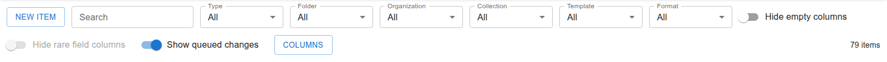

- New item opens the New item dialog (see [New item](#new-item)).
- To fill in (N) shows only the items with a secret field on your To fill in
  list. That list holds the empty secret fields you still have to fill in
  (see [The bwtidy note](../explanation/tool-note.md#what-it-holds)). The
  chip is there while the list is not empty. A second click shows every row
  again.
- Own generator settings (N) shows only the items with a generator setting of
  their own. The chip is there while at least one item has one.
- Search keeps the rows where every word is in some text cell, though never
  in a secret one. It tints the cells that hold a word. Search looks at the
  saved values and not at the queued ones.
- The Type and Folder filters keep the rows with the value you pick, and so
  do Organization and Collection. No folder and No collection keep the items
  without a folder or a collection. Personal keeps the items in your personal
  vault.
- Template keeps the items that match a [template](#templates). It can also
  keep the near misses of a template (Near misses of NAME) or the items that
  match none (No template).
- Format set to Off their format keeps the rows with a value that does not
  fully match its [datatype](#datatypes). An empty value counts too. Partial
  keeps the rows with a value that matches in part.
- Hide empty columns hides the columns with no value in the shown rows.
- Hide rare field columns hides the columns that Rare fields has taken in (see
  [Cells](#cells)). It is off while Rare fields is off and turns on by itself
  once N is above 0.
- Show queued changes shows the changes waiting in the queue as if they were
  written. It is on by default.
- Columns opens the column chooser (see
  [Show or hide columns](../how-to/show-hide-columns.md)). Its Merge selected
  columns opens Merge columns for the two or more columns you selected for
  merge. There you pick the Target column. Clear deselects them.
- N items (or N of M items) says how many rows the filters keep.

### Cells

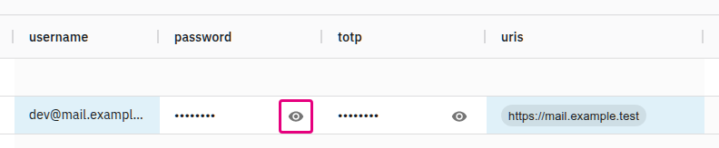

- A double click, Enter or typing edits the cell. A text cell changes in
  place. `login.uris` and `collections` open a list dialog. `folder` offers a
  pick of the folders or a new one and `organization` opens a dialog. A secret
  opens a dialog that never shows the current value, and Show what I type
  shows what you type.
- For the `organization` of a personal item you pick the organization and at
  least one of its collections. An organization without collections cannot
  take an item, so create a collection in Bitwarden first.
- For the `organization` of an organization item the only choice is Personal
  vault. bwtidy then makes a personal copy and moves the item to the trash.
  Its attachments are copied. Its passkeys and password history stay with
  the old item in the trash. Everyone who shares its collections loses the
  item.
- A text or boolean field can sit in a column that is secret on other items.
  It keeps its type, so its dialog says that the value is stored as plain
  text that an agent can read. A boolean field gets a True checkbox and a
  linked field has no value of its own.
- Right click, the context menu key or Shift+F10 opens the
  [cell menu](#cell-menu).
- The eye of a secret cell has Reveal and Hide. Reveal shows the value for 30
  seconds or until the row scrolls away. Hide hides it at once. See
  [Secret values and backups](../explanation/secrets.md).
- The checkbox at the start of a row ticks the item for the
  [selection bar](#selection-bar). Shift-click ticks a range and the header's
  checkbox ticks every shown row.
- `template` shows the matching template. Without a match it shows the best
  near miss with how much of it is filled (`Computer 3/4`). An item is a
  near miss once two things fit, and its type counts as one. Hover a near miss
  for what it lacks. Sorting the column puts the items without a template
  first. The near misses follow from the least filled and the matches come
  last.
- `name` shows the type as a small icon after the name while `type` is
  hidden or scrolled out of view. In the same way it shows the template or
  near miss by its name while `template` is out of view.
- Rare fields (the last column) shows for each item the fields that at most N
  items use. They show as JSON in one cell (`{ "sudo": "", "vlan": "20" }`)
  with a secret value behind an eye. Set N in its header menu, where 0 (the
  default) turns it off. N is kept for the account. Custom fields can go in
  and so can the fields under the item type groups. They are counted over the
  whole vault, so a search or filter never changes which ones go in. The cell
  cannot be edited.
- A double click on a column header's right edge fits the column to its
  content. The column grows to about 50 characters at most.

A cell's look tells you more:

- An amber background means a change waits in the queue. Its tooltip names
  the entry and says when the auto-commit writes your own edits. A cell with
  an agent's proposal cannot be edited until you approve or reject it.
- Faded and struck through means the row is queued for the trash.
- Light purple means the item changed elsewhere since you edited it. The cells
  that changed are a little stronger. The marks stay until your next edit.
- Faint grey means the cell cannot hold a value (a login field on a card, say).
  The tooltip says why.
- An orange outline means the cell is on your To fill in list. A double click
  fills it in.
- A small round mark at the top right shows how well the value matches its
  datatype. It is filled for a full match and half filled for a partial one.
  It stays empty when the value does not match at all.
- A tiny tune icon at the bottom left means the item has its own generator
  setting.
- A corner in the warning color at the top left marks a text field in a
  column that is secret on other items. An agent can read it through MCP.

### Cell menu

Right click a cell to open its menu. The Cell part acts on the cell and the
Row part on the item. Only the entries that fit the cell show. On the
bwtidy note every entry is disabled.


- Reveal value and Hide value do what the eye of a secret cell does. On a
  Rare fields cell they name the secret they show. They are the way to reveal
  a value without a mouse.
- Edit value edits the cell like a double click.
- Remove value removes the value from the item.
- Mark to fill in puts an empty secret cell on your To fill in list. Unmark
  takes a cell off it.
- Generate new value replaces a password or hidden field with a generated
  value after a question. The old value stays in the item's password history.
- Generator settings for this item sets the options of the password generator
  for this item alone. This helps with an app that cannot take long
  passwords. Use the default turns them off again.
- Rename attachments shows on an attachments cell (see
  [Rename an attachment](../how-to/rename-attachment.md)).
- Add field adds a custom field with a name and a value to the item. You
  pick Text or Hidden as its field type. When the item already has an empty
  field of that name, that field keeps its type.
- Convert to template… maps the item's values onto the coordinates of a
  template you pick. For another item type bwtidy creates a new item and moves
  the old one to the trash.
- Merge into item… moves values of this item into another one. Each value goes
  into a column you pick or stays with Don't move. Then this item moves to the
  trash. A list going into a list offers Add to the list or Replace.
- Move to trash moves the item to the trash after a question.

### Header menu

The three dots in a column header open its menu, and so do the context menu
key and Shift+F10 on the header. This is the menu of a field column.

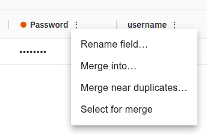

- Rename field… renames the custom field in every item that has it. A name
  that another field already has makes it a merge.
- Merge into… merges the column into a target column you pick.
- Merge near duplicates… merges the column with the columns whose names
  differ only in case or spaces. It is there when such columns exist. A
  colored dot in their headers marks them, and the dot's Merge these does the
  same.
- Select for merge selects the column for Merge selected columns in the
  column chooser. Deselect for merge takes it out.
- Set N in the Rare fields column sets N from 0 to 99 (see Rare fields in
  [Cells](#cells)).
- Manage folders… in the Folder column lists every folder with its number of
  items. Rename gives a folder a new name in place. Save stays off for the
  name of another folder, also when only its case differs (Straße and STRASSE
  count as one name). Delete deletes an empty folder, and a folder that holds
  items cannot be deleted even when they are in the trash or the archive. A
  folder with a rename or delete in the queue takes no other until it is
  written.

A merge that finds items with a value in more than one of the columns asks
which value each of them keeps (Choose the values to keep).

### Selection bar

The selection bar shows below the grid while any row is ticked.

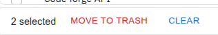

- N selected says how many items are ticked.
- Move to trash moves them all to the trash in one write. One question that
  lists them comes first.
- Clear unticks every row. A search or filter that changes the shown rows
  unticks them too.

### New item

New item adds an item of any type or from a stored template (Start from). The
dialog asks for the Name and Folder and the fields. It also asks for the
Organization when you belong to one.

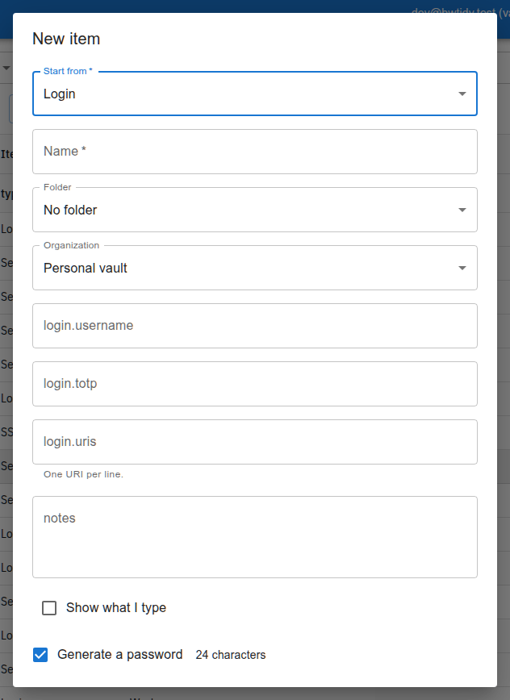

- You type the secret fields in the dialog, where they stay hidden until you
  tick Show what I type. An item started from a type may leave a secret field
  empty, and that field goes on your To fill in list.
- Generate a password shows for a login and is on by default. The password
  is generated and nobody sees it until you reveal it in the grid.
- From a template every required field needs a value that fits its
  datatype's format, or Create stays disabled. A field marked optional may stay
  blank. For a field name pattern (like `user_*`) you name the field too.
- An SSH key needs only its private key in OpenSSH or PEM format without a
  passphrase. bwtidy fills in its public key and fingerprint.
- Create queues the new item. It shows in the grid once it is written.

### Alerts

- bwtidy's note is named "NAME" now shows when the bwtidy note has another
  name than the one it should have, for example after a rename in another
  app. Rename it back gives it that name again. Keep this name keeps NAME and
  the warning goes away (see
  [The bwtidy note](../explanation/tool-note.md#renaming-the-note)).
- Backups not re-encrypted shows after a login with a new master password. The
  backups it names could not be opened with any password bwtidy knows. They
  are left as they were.

## Types

The Types page has two tabs, Templates and Datatypes. A save closes the
editor at once and the list shows a Saving chip until it is written. A
refused save opens the editor again with the reason.

### Templates

A template says which fields an item of a kind should have. An item matches
it when it has the template's type and a value in every required coordinate.
Each value must also fit the coordinate's datatype.

- New template opens the template editor.
- The list has the columns Name, Description and Type. Coordinates shows one
  chip per coordinate with its datatype and `optional` or `pattern`. Matching
  items comes next and then Edit and Delete, where Delete asks first. A
  warning above the list names a template that duplicates an earlier one or a
  datatype that is unknown or broken.

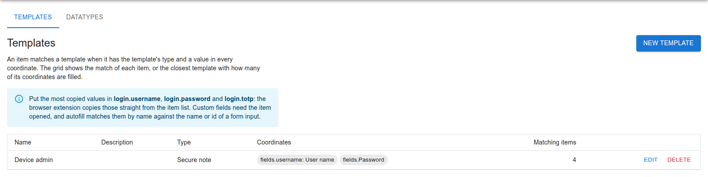

The template editor opens from New template and from Edit.

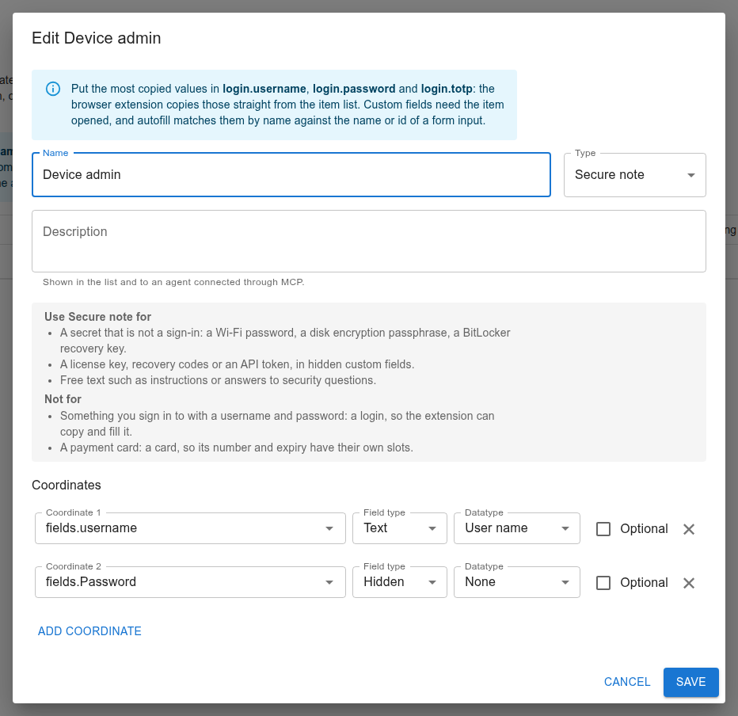

- Name, Type and Description describe the template. Under Type the editor says
  what the type is for and what it is not for.
- Add coordinate adds a row. Its Coordinate picks a built-in slot of the type
  or a field of the vault. New field… picks one the vault does not have yet
  and Field name pattern… a pattern like `user_*` for several fields at once.
- A field or field name pattern also has a Field type of Text, Hidden or
  Boolean. Every row but a Boolean one can take a Datatype. Optional means
  the coordinate is not needed for a match and ✕ removes the row.
- Save saves the template. A coordinate that no item has gets a light warning
  background.
- Save keeps the editor open with the reason for the name of another template,
  also when only its case or the spaces around it differ (Straße and STRASSE
  count as one name). A template can take its own name in another case.
- A New field name that equals a field of the vault apart from case and
  spaces is offered as that field instead.

The values you copy most belong in the built-in login slots `login.username`,
`login.password` and `login.totp`. The Bitwarden browser extension copies
those straight from its item list, while a custom field needs the item opened.

### Datatypes

A datatype is a named pattern that a template coordinate can use. It says how
well a value matches its format and never whether the value is right.

- New datatype opens the datatype editor.
- Pattern limits and statistics opens the [Statistics](#statistics) page.
- The list shows each datatype's Name, Pattern and Description and the
  Coordinates using it. A broken datatype says Broken with the reason next to
  its name. Each row has Edit and Delete, but a datatype that a template uses
  cannot be deleted.

The datatype editor opens from New datatype and from Edit.

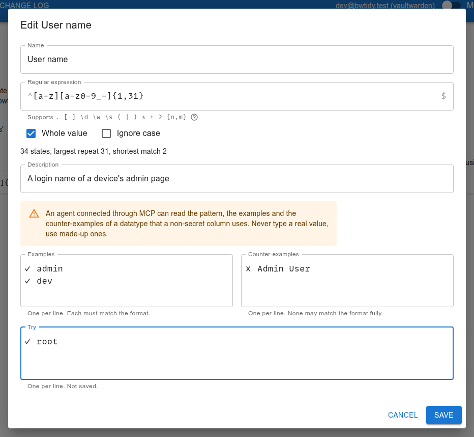

- Name and Description say what the datatype is called and what it is for.
- Regular expression holds the pattern. The help icon after "Supports" lists
  the syntax it takes.
- Whole value means the pattern must match the whole value instead of any
  part of it. Ignore case ignores letter case.
- Under the pattern the editor shows its number of states and its largest
  repeat and its shortest match. A broken pattern shows the error at its
  column instead.
- Examples and Counter-examples take one value per line. The examples must
  match and the counter-examples must not. A tick or a cross marks each line
  and turns red when the line is wrong. Hover it to see how far the line is
  from a match. Make the values up because an agent can read them.
- Try takes values to check and never saves them.
- Save is on once the name is free and the pattern and the examples are
  right.

## Queue

The Queue page shows what waits to be written. Your edits wait for the
auto-commit and an agent's proposals wait for your decision (see
[How edits are saved](../explanation/edits.md)).


An entry sits on one of four tabs and leaves them only while a write runs.
Most entries start on Pending.

```graphviz alt="A new edit or proposal starts on Pending. A proposal that would put a secret value into a plain column goes straight to Rejected. A write takes entries from Pending and moves each to Applied or Failed. Entries that the write does not reach go back to Pending. Reject moves an entry to Rejected. Retry writes a failed entry again and Dismiss deletes it."
digraph {
  rankdir=TB
  nodesep=0.4
  ranksep=0.4
  fontname="sans-serif"
  node [fontname="sans-serif" fontsize=13 shape=box style="rounded,filled" fillcolor="#ffffff" color="#5c6bc0" margin="0.12,0.06"]
  edge [fontname="sans-serif" fontsize=12 color="#455a64"]
  new [label="New" shape=plaintext style=""]
  Pending [fillcolor="#e8eaf6"]
  Applied [fillcolor="#f1f8e9" color="#558b2f"]
  Failed [fillcolor="#fff3e0" color="#e65100"]
  writing [label="Writing" style="rounded,dashed"]
  gone [label="Deleted" shape=plaintext style=""]
  new -> Pending [label="edit or proposal"]
  new -> Rejected [label="secret value refused"]
  Pending -> writing [label="commit or approve"]
  Pending -> Rejected [label="Reject"]
  writing -> Applied [label="written"]
  writing -> Failed [label="not written"]
  writing -> Pending [label="put back"]
  Failed -> writing [label="Retry"]
  Failed -> gone [label="Dismiss"]
}
```

- Pending holds your edits until the next write and an agent's proposals
  until you decide.
- Applied holds the entries written to the vault.
- Rejected holds the entries you rejected. It also holds a proposal that
  bwtidy refused because it would put a secret value into a plain column.
  Nothing of a rejected entry is written.
- Failed holds the entries whose write failed or was cut off. The reason
  says why. After a cut-off the write may still have happened.

Each tab shows the number of its entries you have not seen. A tab that stays
open for 4 seconds counts its entries as seen in this browser.

An entry starts with its summary. Under it come its number and its source
(ui or mcp), then when it was made and its operation. A table lists each
changed cell with its Item and Column and its Before and After. Secret values
are masked.

The Auto-commit box above the tabs sets when your edits are written. After
seconds and Or at changes set the two limits and Save keeps them.

On Pending:

- Tick single entries or use Select all.
- Approve selected writes the ticked entries in one batch with one backup.
  An entry that cannot be written goes to Failed and the rest go on without
  it.
- Reject selected rejects the ticked entries.
- Approve all writes every pending entry in the same way.

On Failed:

- Retry writes the entry again. Over a change made elsewhere it asks first
  (Write over the other change?) and Cancel leaves the entry as it is.
- Retry is missing on an entry whose commit was cut off, as its write may be
  done already. It is also missing on a merge that needs a choice
  per item and on an entry whose secret value is gone after a restart.
- Dismiss deletes the entry and its marks in the grid.

## Change log

The Change log has a row for each change that a write tried and a row for
each backup, newest first. A change's row names the fields it changed and
its backup. That backup is the vault as it was right before the write.


- The filters narrow the rows by time with From and To and by Source and
  Operation. Field, Items and Result narrow them too. Clear filters empties
  them all. Items takes a part of an item's name and asks for more of it when
  over 100 items fit. The page shows the newest 200 rows that match.
- Diff report lists every operation on every field of the shown rows for Copy
  as text. It never holds a value.
- The table shows Time and Source first. Operation follows (hover it for what
  it did) and then Items, Result and Backup.
- The name on a backup's own row downloads the encrypted file. Decrypt it with
  `age -d` and the master password (see [step 1 of the
  restore](../restore.md#1-decrypt-the-backup)).
- Restore on a row puts its items back as that backup holds them. A dialog
  first says what happens to each item. On a folder's row Restore gives the
  folder its old name back or creates a deleted folder again. On an attachment
  rename's row it gives the attachment its old name. The restore is a write
  like any other with a backup first and a row of its own. That row says From
  backup NAME and links to the change it undid while that change is on the
  page.
- A change whose backup is gone (deleted or past the retention) shows the
  backup's name struck through and has no Restore. A screen reader reads the
  name with "(deleted)" after it.
- Changes next to each other that share one backup show it in full on the
  topmost row and fainter on the rows under it. Restore works on each.
- A small restore icon marks a change that a later restore undid. Its tooltip
  says when and which fields of which items.
- Delete on a backup row deletes that backup for good after a question. The
  newest backup cannot be deleted. Neither can one that a running write or a
  queue entry still needs, and the dialog says why.

## Settings

Settings opens from More actions. It has the three sections Display, Password
generator and Delete data. Display holds the first three settings below.

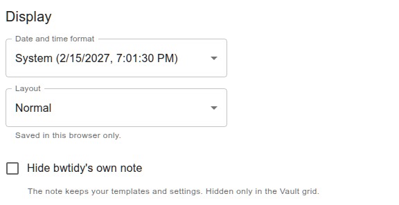

- Date and time format sets how every date and time shows. The choice is
  kept for the account. Each choice shows the current time in its format:
    - System (the browser's own format)
    - ISO 8601
    - Europe
    - Europe (dots)
    - USA
- Layout is Normal or Compact, which fits more in a small window. It is kept
  in this browser only.
- Hide bwtidy's own note leaves the note that keeps your templates and
  settings out of the Vault grid (see
  [The bwtidy note](../explanation/tool-note.md)).
- Password generator picks Password or Passphrase with the options of
  Bitwarden's own generator. Example shows what it makes and Another example
  makes a new one. Save keeps the choice as the default. An item can have its
  own from the cell menu.
- Delete my data deletes every backup, the Change log and the decided queue
  entries. The settings, the MCP token and the templates stay.
- Delete my account deletes the same and also the settings and the MCP token.
  It then logs out of Bitwarden and removes the account from bwtidy.

Both Delete buttons ask you to type your email first. While edits are pending
they ask whether to write them first or drop them.

## Statistics

Statistics opens from Pattern limits and statistics on the Datatypes tab. It
shows how close values and patterns come to the limits of the datatype
checks. bwtidy keeps these numbers in memory for this session only.

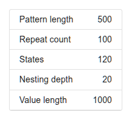

- Limits lists the limits of the checks:
    - the longest pattern
    - the largest repeat count
    - the most states
    - the deepest nesting
    - the longest value bwtidy checks
- Datatypes gives the size of each datatype in States, Largest repeat and
  Shortest match. It counts the values the datatype scored and those that
  were too long. The time of the slowest value and of the last reload in ms
  come last.
- Scored values lists the slowest values scored with a row per item and
  column. It shows the value's length
  (never the value) and its distance from the format. The largest repeat it
  used comes next and then the steps and the time. The slowest come first and
  a click on a header sorts by that column.

## About

About bwtidy opens the About page. It shows the version and the license with
a link to the source code. Another link leads to the Works for me discussion
on GitHub. The page also thanks the projects bwtidy is built on and lists
their packages with their licenses.

If bwtidy works for you, a thumbs up in Works for me helps others decide. A
comment helps even more. Name your bwtidy version and whether you use
Bitwarden or Vaultwarden. Say roughly how many items your vault has. Only what
you post there is shared. bwtidy itself sends nothing.


The version follows [Semantic Versioning 2.0.0](https://semver.org) as
MAJOR.MINOR.PATCH with pre-releases as `-alpha.N`, `-beta.N` and `-rc.N`.
[Road to 1.0](../explanation/road-to-1.0.md) says what the beta promises on the
way to 1.0.0.

The About page shows the version and then the commit the running image was
built from, as in `Version 0.1.0-alpha.1 (261111 7db8830)`. The app bar shows
the short commit faintly after the title (`7db8830`).

## Login pages

The account form, the Bitwarden login and the unlock come before the app (see
[Logging in](../explanation/login.md)). Until someone has logged in with any
account they show a note "Before you start" above the form. It links to the
beta caution in the README on GitHub and to the Works for me discussion. The
form under it works as usual. After the first login of any account the note
never shows again. It comes back only when every account is deleted, as on a
fresh start.

The eye at the end of the master password field shows what you type until
the form is sent. Under the unlock and the Bitwarden login the page names the
account with Switch account to pick another one. The Bitwarden login shows
the account's server and email read-only.


## App bar

- bwtidy (the title) goes to the Vault.
- The links to the four pages come next and the open page is underlined.
  Queue's number counts the pending entries. Its tooltip says how many are
  your unsaved edits and how many are an agent's proposals.
- Commit now writes your unsaved edits at once. It is there while you have
  some.
- A spinner shows while a write runs. Hover it to see the step of the write.
- The account shows the email of the open account. It adds the server's host
  when that is not bitwarden.com.

### MCP

- MCP switches the MCP server on or off for this session. It is green while
  on and the app bar takes on a red tint.
- MCP token shows when the token was made, when it expires and when it was
  last used. It has Create (or Replace) and Remove. A chip next to it warns
  before the token expires. Create and Replace open a dialog with the new
  token and the MCP URL, each with a Copy button. The token shows only once.
  The dialog also links to how to connect your client.


[Connect an MCP client](../how-to/mcp.md) explains how to use both.
[What an agent can do](../explanation/mcp.md) says what they give an agent
and [MCP tools](mcp-tools.md) lists what it can call.

### Color mode

The color mode button opens a menu with the choices System, Light and Dark.
Its icon is a monitor, a sun or a moon to match the choice. System follows the
browser's color scheme. The choice is kept in this browser.

### Log out

Log out asks first. By default it ends the bwtidy session and keeps the
Bitwarden CLI logged in. With "Also log out of Bitwarden" checked it logs the
CLI out too. The next login then runs the Bitwarden login again and
bitwarden.com may email a new device code. Only a running session can log
the CLI out. When the session already ended the page asks you to unlock
first. bwtidy tries to write your unsaved changes before you are logged out.
[Logging in](../explanation/login.md#the-session) explains the session and
its end.

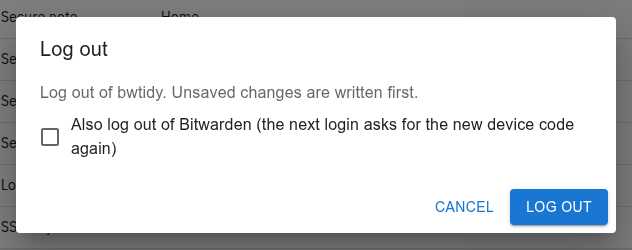

### More actions

The three dots at the right end of the app bar ① open the More actions
menu.


The menu holds Settings, Switch account (while an account is open) and About
bwtidy ②. Settings opens the [Settings](#settings) page. Switch account
tries to write the edits that wait, ends the session and takes you back to the
account form. About bwtidy opens the [About](#about) page.

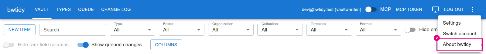

## Keyboard

Everything works without a mouse. Tab and Shift+Tab move between the
controls and every control shows a ring while it has the focus. Escape closes
a menu or a dialog and the focus goes back to what opened it.

The grid is one stop for Tab. Inside it the arrow keys move from cell to cell
and from the headers down into the rows. Tab leaves the grid.

| Key | In the grid |
| --- | --- |
| Arrow keys | Move to the next cell or header |
| Enter or typing | Edit the cell (see [Cells](#cells)) |
| Enter on a header | Sort by the column |
| Space | Tick the row for the [selection bar](#selection-bar) |
| Context menu key or Shift+F10 on a cell | Open the [cell menu](#cell-menu) |
| Context menu key or Shift+F10 on a header | Open the [header menu](#header-menu) |
| Escape | Stop editing and keep the old value |

A screen reader hears the marks a cell shows in color once the cell has the
focus, such as a change waiting in the queue or a field on your To fill in
list. It hears a revealed value and Hidden in place of the dots of a masked
one. A write that starts or ends is said aloud, and so are new proposals from
an agent.
