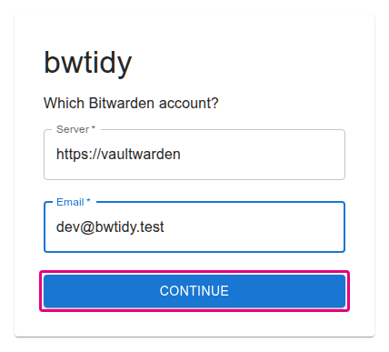
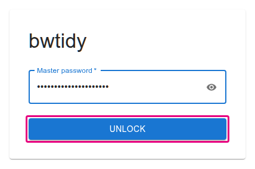
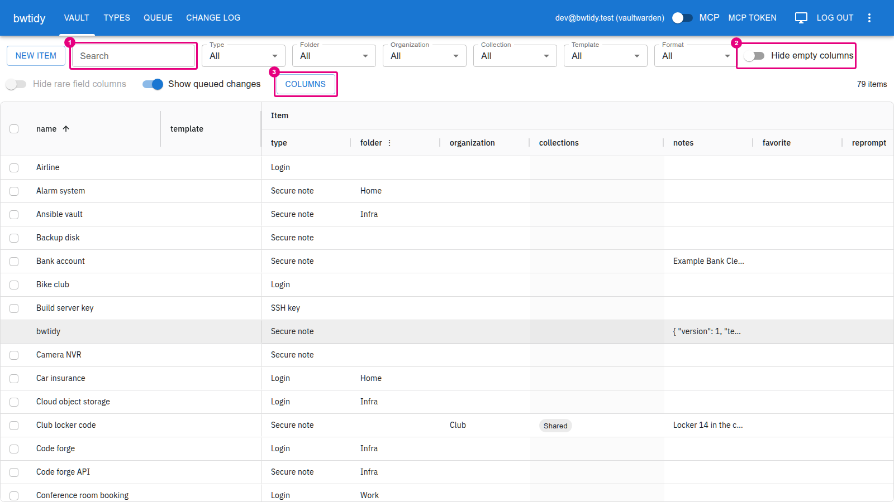
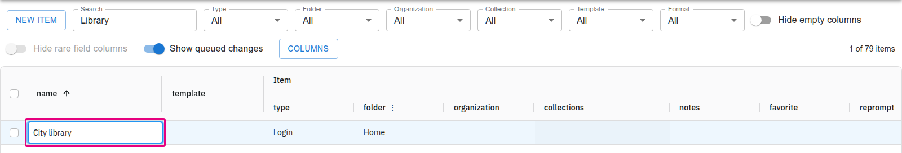
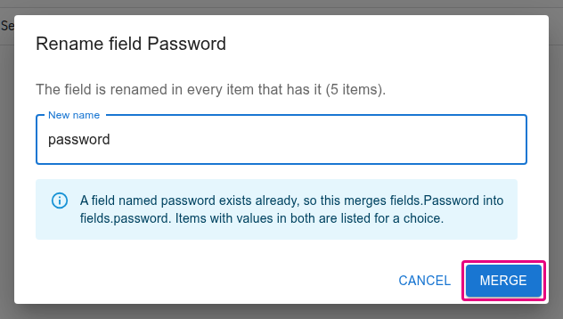

# Your first cleanup

In this tutorial you log in and look around your vault. Then you make two
fixes. One item gets a better name, and a field that several items spell
differently gets one name. You write both to the vault and find them in the
Change log next to the backup that bwtidy takes first.

You need bwtidy running and open in your browser (see
[Run bwtidy](../how-to/run.md)). The pictures show bwtidy's test vault. Where
this page names an item, pick a similar one of your own.

## Log in

Enter your Bitwarden server and email, then click Continue.



The first time, bwtidy offers to create the account and runs a Bitwarden
login that unlocks the vault too (see
[Log in the first time](../how-to/run.md#log-in-the-first-time)). Later
logins ask only for your master password. Type it and click Unlock.



After a few seconds your vault shows.

## Look at the grid

Each item of the vault is a row and each field is a column. The item's own
columns come first and your custom fields come last. In between are the
fields of each item type, such as a login's username or an SSH key's
fingerprint.



- Search (1) shows only the items with the words you type.
- Hide empty columns (2) hides every column that none of the shown items
  fill in.
- Columns (3) picks the columns to show (see
  [Show or hide columns](../how-to/show-hide-columns.md)).

Scroll to the right and you will likely find the same field under a few
names. Tidying those up is what bwtidy is for.

## Fix a name

The login Library is for the city library, so give it a name that says so.
Type `Library` in Search. Then double click its name, type `City library`
and press Enter.



The cell turns amber. That means the change waits in the queue and is not in
the vault yet. A Commit now button shows in the app bar.

## Rename a field in every item

Five notes call their password field `Password` and two others call it
`password`. These steps give them all the same name:

1. Type `Old webshop` in Search and switch on Hide empty columns. Its fields
   are then in view.
2. Click the three dots in the header of `Password` and pick Rename field…
   in its menu.

    

3. Type `password` as the new name. A field of that name exists already, so
   bwtidy merges the two columns. Click Merge. If an item has a value in
   both, a dialog then asks which one it keeps.

    

Switch Hide empty columns off and clear Search to see the whole vault again.

## See it in the Queue

Click Queue in the app bar. Both edits wait under Pending. Each shows its
items and the values before and after (a secret value stays masked).


The auto-commit writes them 180 seconds after the first one unless you
changed that delay (see [How edits are saved](../explanation/edits.md)). If
it has written them already, they are under Applied and Commit now is gone.
Then go on to the Change log.

## Commit

Click Commit now. bwtidy makes sure it has a backup of the vault as it is
and then writes both edits. A spinner in the app bar shows while it works.

## Find it in the Change log

Click Change log. It lists every write with the newest first. Your two edits
go into one write and get a row each that names the items they changed.


A write sits between two backups. The Backup column of your rows names the
backup of the vault as it was right before the write. bwtidy takes that
backup or reuses one that matches the vault. It has its own row further
down, which links to its file. The file is encrypted with your master
password. Right after the write bwtidy starts the next backup in the
background. Its row shows at the top once it is done.

```mermaid alt="A backup is taken or reused before the write and the Backup column of your two rows names it. The write gives each of your two edits a row. After the write the next backup starts in the background and its row shows at the top of the Change log."
flowchart LR
  before[(Backup taken or reused<br>named in the Backup column)] --> write[The write with<br>a row for each edit]
  write --> after[(Next backup started<br>in the background)]
```

Changed your mind? Restore on an edit's row opens a dialog that says what
happens to each item. Once you confirm, it puts them back as that backup
holds them. Keep the edits for now if you go on to the next tutorial,
since it builds on them.

## Next steps

- [Your first template](template.md) is the next tutorial. It continues from
  the vault as you left it.
- [How edits are saved](../explanation/edits.md) explains when edits are
  written and what happens when a write fails.
- [The web UI](../reference/ui.md) describes every page, menu and button.
- [Connect an MCP client](../how-to/mcp.md) so that an AI agent can propose
  cleanups for you to approve.
- [Restore a vault from a backup](../restore.md) without bwtidy.
