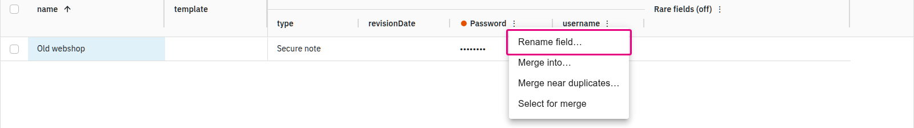
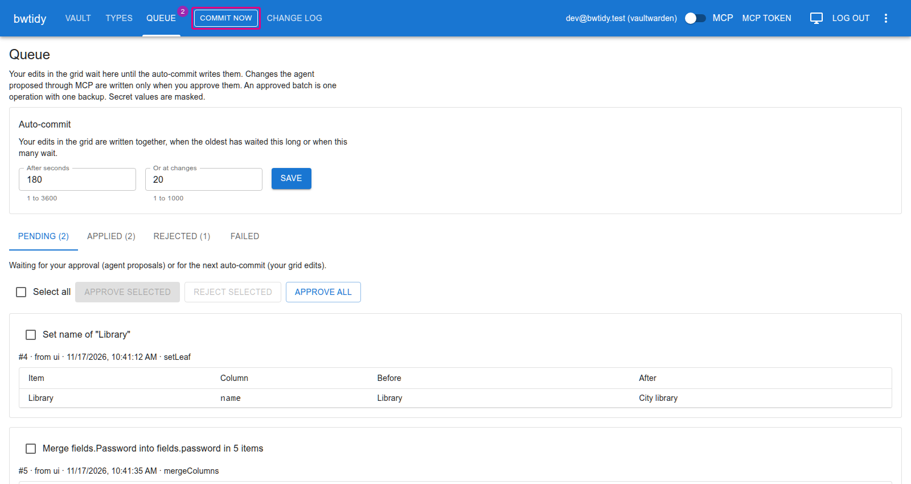
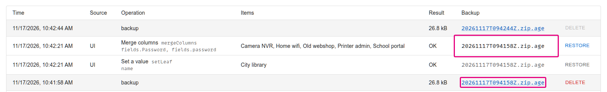

# Your first cleanup

In this tutorial you log in, look around your vault and make two fixes: a
better name for one item, and one name for a field that several items spell
differently. Then you write both to the vault and find them in the Change
log, next to the backup bwtidy took first.

You need bwtidy running and open in your browser (see
[Run bwtidy](../how-to/run.md)). The pictures show bwtidy's test vault, so
where this page names an item, pick a similar one of your own.

## Log in

1. Enter your Bitwarden server and email, then click Continue.

   

   The first time, bwtidy offers to create the account and runs a Bitwarden
   login, see [Log in the first time](../how-to/run.md#log-in-the-first-time).

2. Type your master password and click Unlock.

   

After a few seconds your vault shows.

## Look at the grid

Each item of the vault is a row and each field a column: the item's own
columns first, then the login, card, identity and SSH key fields and your
custom fields.

- Search (1) shows only the items with the words you type.
- Hide empty columns (2) hides every column that none of the shown items
  fill in.
- Columns (3) picks the columns to show, see
  [Show or hide columns](../how-to/show-hide-columns.md).

Scroll to the right and you will likely find the same field under a few
names. Tidying those up is what bwtidy is for.

## Fix a name

The login Library is for the city library, so give it a name that says so.

1. Type `Library` in Search.
2. Double click its name, type `City library` and press Enter.

The cell turns amber: the change waits in the queue and is not in the vault
yet. A Commit now button shows in the app bar.

## Rename a field in every item

Five notes call their password field `Password`, a few others call it
`password`. Give them one name:

1. Type `Old webshop` in Search and switch on Hide empty columns, so its
   fields are in view.
2. Click the three dots in the header of `Password` and pick Rename field…
   in its menu.

   

3. Type `password` as the new name. A field of that name exists already, so
   bwtidy merges the two columns. If an item had a value in both, you would
   pick the one to keep next. Click Merge.

   

Switch Hide empty columns off and clear Search to see the whole vault again.

## See it in the Queue

Click Queue in the app bar. Both edits wait under Pending, each with its
items and the values before and after (a secret value stays masked).

Left alone, they are written by the auto-commit within 180 seconds (see
[How edits are saved](../explanation/edits.md)).

## Commit

Click Commit now. bwtidy makes sure it has a backup of the vault as it is,
then writes both edits. A spinner in the app bar shows while it works.

## Find it in the Change log

Click Change log. It lists every write, newest first. Your two edits went
in one write, with a row each that names the items they changed.

The Backup column names the backup of the vault as it was right before the
write. That backup's own row, further down, links the file, encrypted with
your master password. The backup at the top was taken right after the
write, ready for the next one.

Changed your mind? Restore on an edit's row puts its items back as that
backup holds them.

## Next steps

- [Your first template](template.md), the next tutorial: it continues from
  the vault as you left it.
- [How edits are saved](../explanation/edits.md): when edits are written and
  what happens when a write fails.
- [The web UI](../reference/ui.md): every page, menu and button.
- [Connect an MCP client](../how-to/mcp.md), so an AI agent can propose
  cleanups for you to approve.
- [Restore a vault from a backup](../restore.md), without bwtidy.
