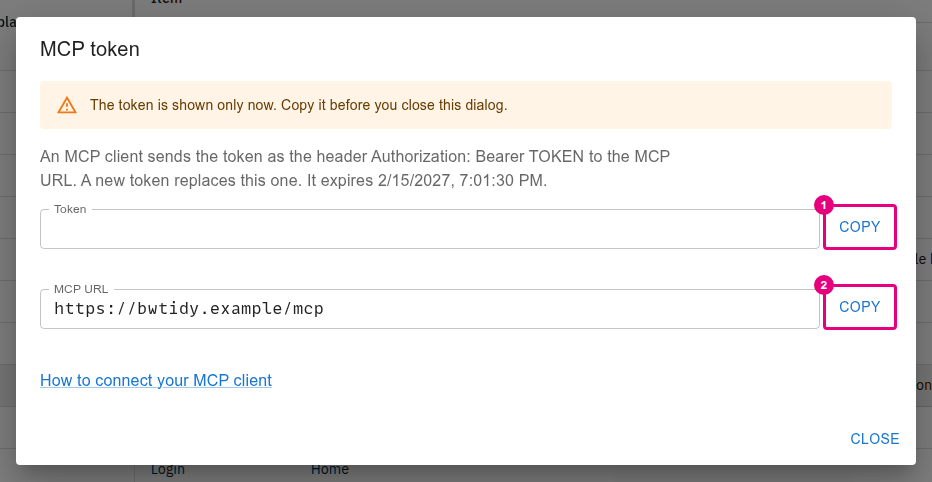
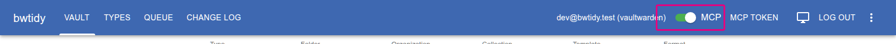
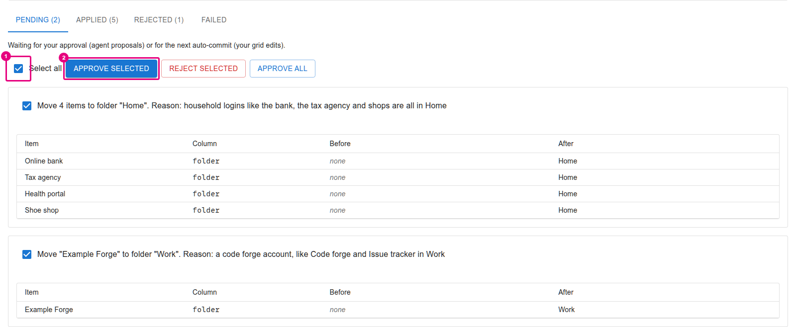
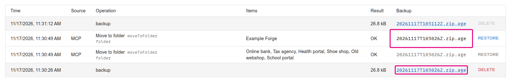

# Your first MCP-assisted cleanup

In this tutorial you connect an AI agent to bwtidy and ask it to sort the
logins that are in no folder. The agent looks through your vault and
proposes the moves. You review its proposals on the Queue page and approve
them.
Then you find the write and its backup in the Change log.

This tutorial continues from [Your first template](template.md) with the
vault as you left it, and you are still logged in. Old webshop and School
portal are logins in no folder now, so your agent finds them too. If you
start here they are still notes and the agent leaves them out.

You also need an AI client that speaks MCP.
[Connect an MCP client](../how-to/mcp.md) has the setup for four of them.
The pictures show bwtidy's test vault and only the app's side. What the
agent says depends on the agent.

You, your agent and bwtidy each have a part in this tutorial. You set up
bwtidy and the agent. The agent proposes changes and only you decide which
ones bwtidy writes.

```mermaid alt="You make a token in bwtidy and switch MCP on. You connect your agent with the token and the MCP URL and ask it for a cleanup. The agent lists your items and folders and proposes the moves, which wait on the Queue page. You approve them there and bwtidy writes them with a backup of the vault before the write. The Change log then shows the write and its backup."
sequenceDiagram
  participant Agent as AI agent
  actor You
  participant bwtidy
  You->>bwtidy: Make a token and switch MCP on
  You->>Agent: Connect with the token and the MCP URL
  You->>Agent: Ask for a cleanup
  Agent->>bwtidy: List the items and folders
  Agent->>bwtidy: Propose the moves
  Note over bwtidy: The proposals wait on the Queue page
  You->>bwtidy: Approve them on the Queue page
  Note over bwtidy: The write with a backup before it
  You->>bwtidy: Look in the Change log
```

## Make a token

The token lets your client in and picks your account. You click through a
menu and two dialogs to make it.

1. Click MCP token in the app bar, then Create.

    

2. Keep the lifetime of 90 days and click Create.
3. The dialog shows the token once. Copy the token ① and paste it
   somewhere safe for a minute. Then copy the MCP URL ② too.

    

> [!WARNING]
> bwtidy keeps only a hash of the token. Close the dialog only once you
> have copied both.

## Switch MCP on

Click the MCP switch in the app bar. It turns green and the app bar takes
on a red tint, which shows that MCP is on for this session.



Every login starts with MCP off. Switch it on again the next time you log
in.

## Connect your client

Add bwtidy to your client with the token and the MCP URL you copied.
[Connect an MCP client](../how-to/mcp.md) has the setup for each of these
clients:

- [Claude Code](../how-to/mcp.md#claude-code)
- [Codex](../how-to/mcp.md#codex)
- [GitHub Copilot CLI](../how-to/mcp.md#github-copilot-cli)
- [Gemini CLI](../how-to/mcp.md#gemini-cli)

Then start a new session of your client so that it loads bwtidy's tools.

## Ask for a cleanup

Type this prompt into your agent.

```text
Use bwtidy to find the logins in my vault that are in no folder. Propose
moving each of them into the folder where it fits best (Work, Home or Infra).
Give a reason with each proposal.
```

The test vault has the folders Work, Home and Infra. Name your own folders
in the prompt if yours differ.

The agent lists your items and folders. Then it calls a propose tool once
for each folder it moves logins into and tells you what it proposed. Nothing
has changed in your vault yet. Each proposal waits on the Queue page for
you.

In the pictures the agent proposes to move six logins into Home and Example
Forge into Work. Old webshop and School portal are among the six. Your agent
may group the logins differently or leave some where they are.

## Review the proposals

Click Queue in the app bar. Its badge counts the entries that wait there.
Each proposal shows its summary with the agent's reason. A table under it
lists every item with the column it changes and the value before and after.



Read them as you would read a colleague's suggestions. The auto-commit never
writes an agent's proposal, so they wait until you decide.

Tick Select all ①, which ticks every pending entry. Untick a proposal you
do not agree with and it stays pending. To turn it down for good you tick it
alone and click Reject selected.

Click Approve selected ②. bwtidy makes sure it has a backup of the vault
as it is and then writes the approved proposals. A message above the list
names them and the backup.

## Find it in the Change log

Click Change log. Each approved proposal has a row that shows MCP as its
source and names the items it moved.



The Backup column names the backup of the vault as it was right before the
write. That backup has its own row further down, which links to its file.
Restore on one of these move rows opens a dialog. Once you confirm it puts
the row's items back in no folder.

When you are done, switch MCP off. The token stays valid until it expires.
To end it sooner you click Remove in the MCP token menu.

## Next steps

- [What an agent can do](../explanation/mcp.md) explains what an agent sees
  and may propose. It also says why the agent never sees a secret value.
- [MCP tools](../reference/mcp-tools.md) lists every tool your agent can
  call.
- [Connect an MCP client](../how-to/mcp.md#look-after-the-token) says how
  to look after the token.
- Your agent can use the templates from
  [Your first template](template.md) too.
