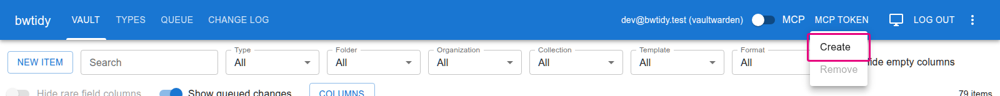

# Clean up with an AI agent

In this tutorial you connect an AI agent to bwtidy and ask it to sort the
logins that are in no folder. The agent looks through your vault and
proposes the moves. You review its proposals in the Queue, approve them,
and find the write and its backup in the Change log.

This tutorial continues from [Your first template](template.md): you are
logged in, and Old webshop and School portal are logins in no folder now, so
your agent finds them too. If you start here, they are still notes and the
agent leaves them out. You also need an AI client that speaks MCP, such as
Claude Code, Codex, GitHub Copilot CLI or Gemini CLI. The pictures show
bwtidy's test vault and only the app's side: what the agent says depends on
the agent.

## Make a token

The token lets your client in, and picks your account.

1. Click MCP token in the app bar, then Create.

    

2. Keep the lifetime of 90 days and click Create.
3. The dialog shows the token once. Copy the token (1) and keep it where
   you can paste it in a minute, then copy the MCP URL (2) too.

    

bwtidy keeps only a hash of the token, so close the dialog only once you
have both.

## Switch MCP on

Click the MCP switch in the app bar. It turns green and the app bar takes
on a red tint: an agent can reach bwtidy now.


Every login starts with MCP off, so next time switch it on again.

## Connect your client

Add bwtidy to your client with the token and the MCP URL you copied. Each
client takes one command, see [Connect an MCP client](../how-to/mcp.md):
[Claude Code](../how-to/mcp.md#claude-code), [Codex](../how-to/mcp.md#codex),
[GitHub Copilot CLI](../how-to/mcp.md#github-copilot-cli) or
[Gemini CLI](../how-to/mcp.md#gemini-cli).

Start a new session of your client, so it loads bwtidy's tools.

## Ask for a cleanup

Type this into your agent:

```text
Use bwtidy to find the logins in my vault that are in no folder. Propose
moving each of them into the folder where it fits best: Work, Home or Infra.
Give a reason with each proposal.
```

The agent lists your items and folders, then calls a propose tool once for
each folder. It tells you what it proposed. Nothing is in your vault yet:
each proposal waits in the Queue for you. In the pictures it moves six
logins into Home, Old webshop and School portal among them, and Example
Forge into Work. Your agent may group the logins differently, or leave some
where they are.

## Review the proposals

Click Queue in the app bar. Its badge counts the new proposals. Each one
shows its summary with the agent's reason, and a table with every item, the
column it changes and the value before and after.


Read them as you would a colleague's suggestion. Untick a proposal you do
not agree with, or reject it with Reject selected. The auto-commit never
writes an agent's proposal, they wait for you.

Tick Select all (1) and click Approve selected (2). bwtidy makes sure it has
a backup of the vault as it is, then writes the approved proposals. A
message above the list names the backup.

## Find it in the Change log

Click Change log. Each approved proposal has a row with the source MCP and
the items it moved.


The Backup column names the backup of the vault as it was right before the
write, and that backup's own row links the file. Restore on a row puts its
items back in no folder.

When you are done, switch MCP off. The token stays valid until it expires,
Remove in the MCP token menu turns it off before that.

## Next steps

- [What an agent can do](../explanation/mcp.md): what it sees, what it may
  propose, and why it never sees a secret value.
- [MCP tools](../reference/mcp-tools.md): every tool your agent can call.
- [Connect an MCP client](../how-to/mcp.md#look-after-the-token): look after
  the token.
- [Your first template](template.md): templates your agent can use too.
