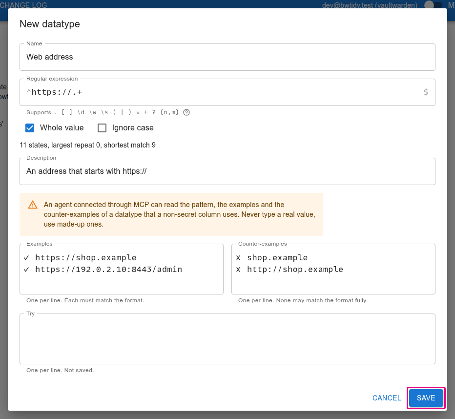
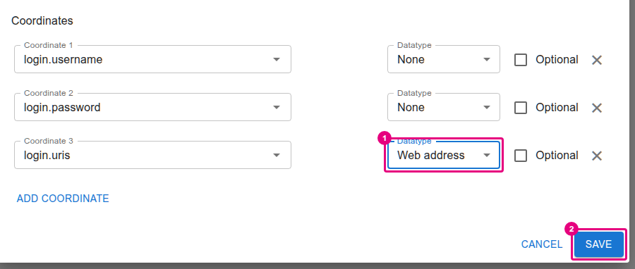
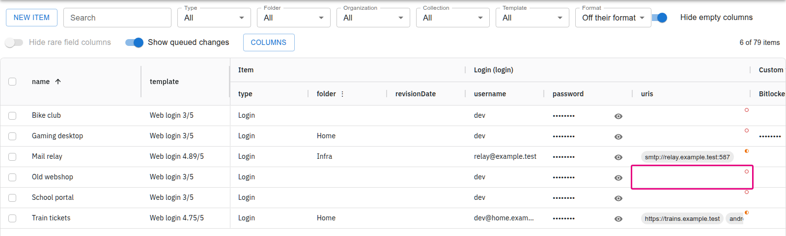
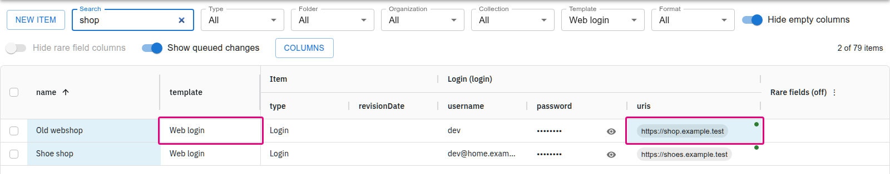

# Your first template

In this tutorial you describe what a web login looks like. You make a
datatype that says how a web address starts and a template for logins that
uses it. The grid then shows which logins fit and which do not. Two notes
are really logins, so you turn them into logins with the template. You give
them an address while bwtidy checks it and find the writes in the Change log.

This tutorial continues from [Your first cleanup](first-cleanup.md). You are
logged in and the custom field `Password` is renamed to `password` in every
item. The pictures show bwtidy's test vault. Where this page names an item,
pick a similar one of your own.

## Make a datatype

A datatype is a pattern for one kind of value. It says how well a value
matches its format and never whether the value is right.

1. Click Types in the app bar, then the Datatypes tab and then New datatype.
2. Type `Web address` as the Name and `https://.+` as the Regular
   expression. Whole value is ticked, so the pattern must match the whole
   value. The field shows a `^` before it and a `$` after it.
3. Type `An address that starts with https://` as the Description.
4. Under Examples type `https://shop.example` and
   `https://192.0.2.10:8443/admin` with one value per line. Under
   Counter-examples type `shop.example` and `http://shop.example` the same
   way. Each line gets a tick when
   it matches and a cross when it does not. The mark is red when the line is
   on the wrong side.

    

5. Click Save.

> [!WARNING]
> Make up your examples. An agent connected through MCP can read them, so
> never type a real address or password there.

## Make a template

A template says which values an item of one type should have. An item
matches it when it has the template's type and a value in every coordinate.
A coordinate is a place in an item such as `login.uris`. Where a coordinate
has a datatype, its value must fit it too.

1. Click the Templates tab and then New template.
2. Type `Web login` as the Name and pick Login as the Type. Type
   `A login to a website or a device's web page.` as the Description.
3. Click Add coordinate and pick `login.username`. Do the same for
   `login.password` and `login.uris`.
4. In the row of `login.uris` pick Web address as the Datatype ①. Then
   click Save ②.

    

bwtidy keeps the datatype and the template in the bwtidy note in your vault. It
saves them right away (see [The bwtidy note](../explanation/tool-note.md)).

## See it in the grid

Click Vault. The template column now says Web login for most of your
logins. Pick Off their format in the Format filter ① and switch on Hide
empty columns. The grid then keeps the logins whose address is missing or
does not fit Web address.


For a near miss the template column shows the fill score. `Web login 3/5`
means that the item has 3 of the 5 things the template counts. These are its
type, the three coordinates and the format of the address. Bike club counts
them like this.

```mermaid alt="The fill score of Bike club. Its type is Login and login.username and login.password have a value, for one point each. login.uris is empty and the missing address cannot fit Web address, for no points. That makes Web login 3/5."
flowchart LR
  type["Is the type Login?<br>yes, 1 point"] --> score(["Bike club<br>Web login 3/5"])
  username["Does login.username have a value?<br>yes, 1 point"] --> score
  password["Does login.password have a value?<br>yes, 1 point"] --> score
  uris["Does login.uris have a value?<br>no, 0 points"] --> score
  format["How well does the address fit Web address?<br>no address, 0 points"] --> score
  classDef miss stroke-dasharray: 5 5
  class uris,format miss
```

An address that fits in part earns part of its point. Mail relay has four
full points and 0.89 for the format of its `smtp://` address.

The small round mark in the top right corner of a uris cell ② shows how
well the address matches Web address. It is filled for a full match and half
filled for part of one. It stays empty for none. Bike club and Gaming
desktop have no address at all.

Point at the template cell of Mail relay to see what keeps it from a match.


Its address starts with `smtp://` and that is right for a mail server. A
datatype checks the shape of a value. A near miss is therefore a hint to
look and not an error.

## Turn two notes into logins

The notes Old webshop and School portal hold a username and a password in
custom fields. They are logins in disguise that the browser extension cannot
fill in. The template turns them into logins.

1. Set the Format filter back to All and switch off Hide empty columns. Then
   type `Old webshop` in Search.
2. Right click its name and pick Convert to template… in the menu. Pick Web
   login as the Template.
3. bwtidy pairs the values by name. `fields.username` goes into
   `login.username` and `fields.password` into `login.password`. It is still
   `fields.Password` if you did not rename it in the first tutorial. Leave
   `login.uris` empty and click Convert.

    

    The note is a Secure note but the template is for a Login. The commit
    therefore creates a new login with the values and moves the note to the
    trash. The dialog says so too.

4. Do the same for School portal.
5. Clear Search and click Commit now in the app bar.

## Add the address

Pick Off their format in the Format filter again and switch on Hide empty
columns. Old webshop and School portal are logins now at `Web login 3/5`.
Their mark is empty because they still lack an address.



Double click the uris cell of Old webshop and type `shop.example.test`. The
line under it says how far the address is from Web address and what it
expected.


Put `https://` in front. The line then says matches format. Click Save.

Give School portal the address `https://school.example.test` the same way
and click Commit now.

The two logins then leave the filtered grid because they fit the template.
Set the Format filter to All and pick Web login in the Template filter. Then
type `shop` in Search.



Old webshop says Web login just like Shoe shop. Its address has a filled
mark.

## Find it in the Change log

Click Change log. The conversion of the two notes goes into one write ①
and the two addresses into the next ②. Each write names the backup of
the vault as it was right before it. The conversion rows name the notes by their
id because the notes are in the trash. Further down the saves of the datatype
and the template have rows of their own as writes to the bwtidy note.


Changed your mind? Restore on a conversion's row asks first. Once you
confirm it brings the note back from the trash and moves the new login
there. Keep the logins if you go on to the
next tutorial, since it builds on them.

## Next steps

- [The web UI, Types](../reference/ui.md#types) describes every field of the
  template and datatype editors, such as optional coordinates and field name
  patterns.
- [The web UI, Toolbar](../reference/ui.md#toolbar) describes the Template
  and Format filters.
- [Your first MCP-assisted cleanup](mcp.md) is the next tutorial. An agent
  sees your templates and how well each item fits them. It can propose
  applying one.
