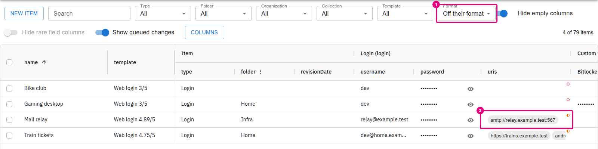
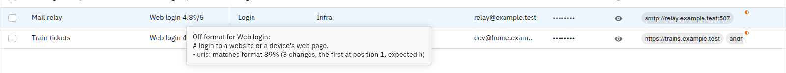
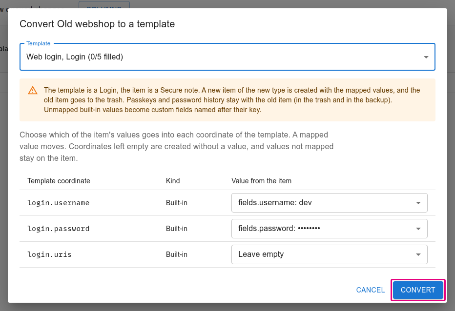
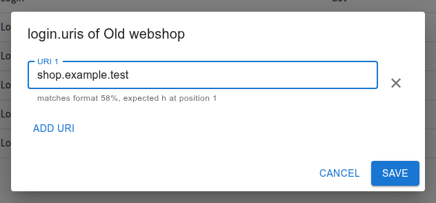
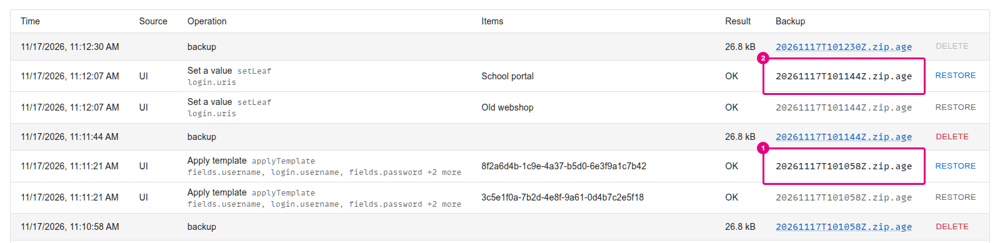

# Your first template

In this tutorial you describe what a web login looks like: a datatype that
says how a web address starts, and a template for logins that uses it. The
grid then shows which logins fit and which do not. You turn two notes that
are really logins into logins with the template, give them their address
while bwtidy checks it, and find the writes in the Change log.

This tutorial continues from [Your first cleanup](first-cleanup.md): you
are logged in, and the custom field `Password` is `password` in every item.
The pictures show bwtidy's test vault, so where this page names an item,
pick a similar one of your own.

## Make a datatype

A datatype is a pattern for one kind of value. It says how well a value
matches its format, never whether the value is right.

1. Click Types in the app bar, then the Datatypes tab, then New datatype.
2. Type `Web address` as the Name and `https://.+` as the Regular
   expression. Whole value is ticked, so the pattern must match the whole
   value: the field shows a `^` before it and a `$` after it.
3. Type `An address that starts with https://` as the Description.
4. Under Examples type `https://shop.example` and
   `https://192.0.2.10:8443/admin`, one per line. Under Counter-examples
   type `shop.example` and `http://shop.example`. Each line gets a tick when
   it matches and a cross when it does not, red when it is on the wrong
   side.

    

5. Click Save.

Make up your examples. An agent connected through MCP can read them, so
never type a real address or password there.

## Make a template

A template says which values an item of one type should have. An item
matches it when it has the template's type and a value in every coordinate
(a place in an item, like `login.uris`), each value fitting its datatype.

1. Click the Templates tab, then New template.
2. Type `Web login` as the Name, pick Login as the Type and type
   `A login to a website or a device's web page.` as the Description.
3. Click Add coordinate and pick `login.username`. Do the same for
   `login.password` and `login.uris`.
4. In the row of `login.uris`, pick Web address as the Datatype (1), then
   click Save (2).

    

bwtidy keeps the datatype and the template in its own note in your vault
and saves them right away, see [The bwtidy note](../explanation/tool-note.md).

## See it in the grid

Click Vault. The template column now says Web login for most of your
logins. Pick Off their format in the Format filter (1) and switch on Hide
empty columns: the grid keeps the logins that come close to the template
but do not fit it.

- The template column shows the fill score: `Web login 3/5` means the item
  has 3 of the 5 things the template counts (its type, the three
  coordinates and the format of the address).
- The small round mark in the top right corner of a uris cell (2) shows how
  well the address matches Web address: filled for a full match, half filled
  for part of it, empty for none. Bike club and Gaming desktop have no
  address at all.

Point at the template cell of Mail relay to see what keeps it from a match.

Its address starts with `smtp://`, and that is right for a mail server. A
datatype checks the shape of a value, so a near miss is a hint to look, not
an error.

## Turn two notes into logins

The notes Old webshop and School portal hold a username and a password in
custom fields. They are logins in disguise, and the browser extension
cannot fill them in. The template turns them into logins.

1. Set the Format filter back to All, switch off Hide empty columns and type
   `Old webshop` in Search.
2. Right click its name and pick Convert to template…, then pick Web login
   as the Template.
3. bwtidy pairs the values by name: `fields.username` goes into
   `login.username` and `fields.password` into `login.password` (still
   `fields.Password` if you did not rename it in the first tutorial). Leave
   `login.uris` empty and click Convert.

    

    The note is a Secure note and the template a Login, so bwtidy creates a
    new login with the values and moves the note to the trash, as the
    dialog says.

4. Do the same for School portal.
5. Clear Search and click Commit now in the app bar.

## Add the address

Pick Off their format in the Format filter again and switch on Hide empty
columns. Old webshop and School portal are logins now, at `Web login 3/5`,
with an empty mark: they still lack an address.

1. Double click the uris cell of Old webshop and type `shop.example.test`.
   The line under it says how far the address is from Web address, and
   what it expected.

    

2. Put `https://` in front. The line says matches format. Click Save.
3. Give School portal the address `https://school.example.test` the same
   way.
4. Click Commit now.

The two logins leave the filtered grid: they fit the template now. Set the
Format filter to All, pick Web login in the Template filter and type `shop`
in Search.

Old webshop says Web login, like Shoe shop, and its address has a filled
mark.

## Find it in the Change log

Click Change log. The conversion of the two notes goes into one write (1),
the two addresses into the next (2), each with the backup bwtidy takes right
before it. The conversion rows name the notes by their id, as the notes are in
the trash. Further down, the saves of the datatype and the template
have rows of their own, as writes to the bwtidy note.

Changed your mind? Restore on a conversion's row brings the note back from
the trash and moves the new login there.

## Next steps

- [The web UI, Types](../reference/ui.md#types): every field of the template
  and datatype editors, such as optional coordinates and field name
  patterns.
- [The web UI, Toolbar](../reference/ui.md#toolbar): the Template and Format
  filters.
- [Your first MCP-assisted cleanup](mcp.md): an agent sees your templates and how
  well each item fits them, and can propose applying one.
